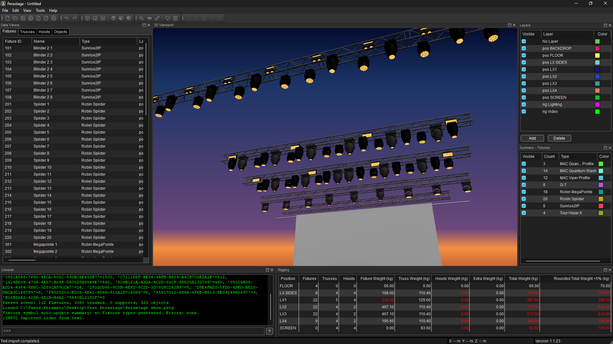

# Perastage

  
  
  
  
  
  
  

**Perastage is a free, cross-platform desktop application for practical MVR and GDTF workflows.**

Open, inspect, edit and document stage scenes, work with GDTF fixture definitions, review projects in 2D and 3D, build production layouts and export interoperable MVR files.

Perastage is not intended to be a real-time DMX visualizer.

[Website](https://perastage.luismaperamato.com/) · [Documentation](https://perastage.luismaperamato.com/documentation.html) · [Download](https://github.com/PeramatoG/Perastage/releases/latest)

## Highlights

- **MVR workflows:** open, merge, edit and export stage scenes.
- **GDTF libraries:** maintain local fixture definitions and download profiles from GDTF Share.
- **MVR / GDTF Inspector:** read-only inspection of projects and external packages.
- **2D and 3D:** review plans and spatial relationships.
- **Scene editing:** practical table, patch and grouping tools.
- **Create from Text:** generate starting scenes from production notes and riders.
- **Layouts and PDF:** build production layouts and export technical documentation.
- **Fixture resources:** project fixture symbols and standards-oriented GDTF workflows.
- **Experimental local integration:** OSC and MCP for separately configured automation.
- **Cross-platform:** Windows, macOS and Linux.

See the [feature overview](docs/user/features.md) for details.

## Installation

### Download

[Download the latest release](https://github.com/PeramatoG/Perastage/releases/latest) for Windows, macOS or Linux, then follow the [installation guide](docs/user/installation.md).

### Build from source

See the [developer build guide](docs/developer/build.md) for source-build instructions.

## Getting started and documentation

Use the [online documentation](https://perastage.luismaperamato.com/documentation.html) or these repository guides:

- [Quick Start](docs/user/quick-start.md)
- [Feature overview](docs/user/features.md)
- [Troubleshooting](docs/user/troubleshooting.md)
- [Developer documentation](docs/developer/index.md)

The installed offline user manual is available in English, Spanish and Simplified Chinese.

## Contributing

[Report bugs, suggest workflow improvements or share MVR/GDTF compatibility cases](https://github.com/PeramatoG/Perastage/issues). For development, start with the [developer documentation](docs/developer/index.md).

## License

Perastage is distributed under the GNU General Public License version 3 or later (`GPL-3.0-or-later`). See [LICENSE.txt](LICENSE.txt).

## Author

Perastage is developed and maintained by **Luisma Peramato** (GitHub: `PeramatoG`).
