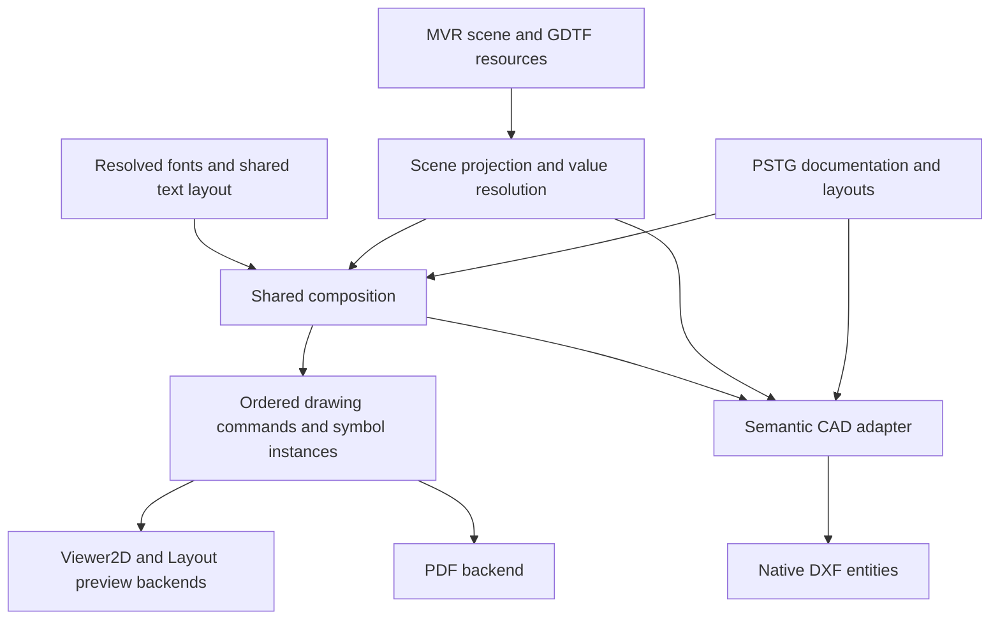

# Perastage 1.8.0: documentation, MVR and CAD architecture audit

Audit date: **2026-10-18**. This is an architecture and compatibility audit;
it introduces no application, build, dependency, test or release changes.

## 1. Executive summary and evidence policy

The foundation should be **one scene model, one persistent documentation model,
and shared derived composition**, with format-specific rendering and exchange
adapters. MVR remains authoritative for scene exchange. PSTG owns Perastage
documentation. PDF, DXF and any future DWG are representations of those inputs.
Do not add a second scene model or put proprietary drawing entities in MVR.

**D — Absolute P0:** MVR standards compliance and lossless preservation of valid
standard data take precedence over every Layout, typography, annotation and CAD
milestone. This is an independent scene/interchange obligation, even if the
Layout roadmap is delayed or cancelled. Focus is the first traced example,
not the boundary of the preservation requirement.

Unknown or unsupported valid standard information must **never be silently
discarded** on import, editing, merge, canonical export or PSTG save/restore.
Lack of an editor or renderer is not permission to remove it. Retain its
structure, values, references and resources through a lossless representation
(including opaque retention where necessary), with explicit support diagnostics.
If safe preservation cannot be guaranteed, block the destructive write with an
actionable diagnostic and retain the original source; a warning followed by
silent truncation does not meet this requirement. Any deliberately lossy
conversion must be a separately selected, clearly diagnosed operation.

### Separate acceptance criteria

**D:** Require all three checks; passing one does not establish the others:

| Criterion | Required evidence |
| --- | --- |
| Standards compliance | Output satisfies the declared MVR version's published requirements, schema, semantic/reference and package rules; specification/schema conflicts are recorded explicitly. |
| Canonical output | The same current scene produces the agreed deterministic representation and identity/resource policy through the shared serializer; compatibility representations remain explicit. |
| Semantic round-trip preservation | Import → editable domain → export and MVR → PSTG → MVR retain valid authored standard values, identities, hierarchy, transforms, references and resources except user-intended changes, including information the application cannot edit or render. |

Canonical normalization may change insignificant XML formatting; it must not
justify dropping information or rounding away authored meaning. A stable,
schema-valid canonical subset can still fail semantic round-trip preservation.

The most urgent findings are:

1. **Confirmed by source code:** imported FocusPoint nodes are visible to
   Inspection but absent from editable `MvrScene`. `Fixture::focus` is imported
   and remapped during merge, but omitted by export. Canonical project save
   uses that exporter, so PSTG packaging does not repair this loss.
2. **Confirmed by source code:** page text shares a rich-text extraction helper,
   but preview and PDF independently choose font metrics, baselines and line
   advances. PDF uses WinAnsi and replaces unsupported Unicode with `?`.
   The layout typography compensation factor is not a universal text fix.
3. **Design recommendation:** preserve and extend `LayoutCollection`, existing
   symbol ownership/resolution, `CommandBuffer`, Query Core and Command Core.
   Place native dimensions and scene-linked annotation semantics above drawing
   commands; never infer a dimension from an arbitrary group of strokes.
4. **Design recommendation:** first qualify semantic DXF model-space export and
   bounded reference import. Then add paper-space layouts. Native TEXT/MTEXT,
   BLOCK/INSERT, DIMENSION and layers take precedence over blanket flattening.
5. **Design recommendation:** treat DWG as a later, independently qualified
   adapter. GPL-compatible candidates exist, but native CAD interoperability,
   library version coverage and deployment have not been demonstrated here.

### Evidence classifications

The following labels apply throughout, including the abbreviated table keys:

| Key | Classification | Meaning |
| --- | --- | --- |
| C | **Confirmed by source code** | Directly traced in the audited revision; does not imply runtime or third-party application verification. |
| S | **Confirmed by official specification** | Defined by the primary specification/schema or format reference cited below. Library licensing statements identify the inspected upstream license evidence separately. |
| V | **Likely issue requiring runtime validation** | A specific observable consequence is plausible but has not been reproduced in this audit. |
| D | **Design recommendation** | Proposed future behavior or boundary; no implementation is included. |
| U | **Unresolved** | Requires a decision, additional evidence, or external qualification. |

### Revision and recent-work context

**C:** The dedicated audit branch starts at remote `main`
[`6afac6e9a798ea7118e48edcf6b8173b951bf3bf`](https://github.com/PeramatoG/Perastage/commit/6afac6e9a798ea7118e48edcf6b8173b951bf3bf),
version **1.7.5**, fetched during this audit. Source references below are relative
to this revision, not a promise about future `main`.

Relevant history inspected with path-scoped Git logs and current source:

| Work | Consequence for this proposal |
| --- | --- |
| `474c1b28`, Layer UUID identity and ownership | Reuse the canonical UUID layer domain; do not revive name-based identity. |
| `25c2b263`, PSTG fixture symbol ownership and standard GDTF completion | Preserve project overrides, migration and standard SVG precedence. |
| `1375374e`, atomic targeted batch transforms; `387bc599`, Console frontend | Reuse semantic commands and transaction publication rather than parse text inside tools. |
| `cb5ef06c`, layout PDF symbol usage; `901cb47b`, packaged layout images; `44898834`, portable templates | Extend these services rather than create new exporters/resource registries. |
| `3bfd1495` / `cd35738f`, MVR XML serialization ownership | Keep orchestration separate from resolved-value XML writers. |
| [Merged PR #2473](https://github.com/PeramatoG/Perastage/pull/2473), GDTF matching/import queue | Keep original-reference recovery, automatic mode evidence and import resource lifetime rules. |
| [Open draft PR #2474](https://github.com/PeramatoG/Perastage/pull/2474), head `8edb0d3c` | Metadata and complete changed-file list inspected. It changes GDTF selection GUI actions, presentation, tests and manuals; it does not change Focus serialization, drawing semantics or PDF. Its proposed behavior is not treated as merged. |
| [Merged PR #2475](https://github.com/PeramatoG/Perastage/pull/2475) | Downloads/site/release automation explains latest main; it is outside drawing architecture. |

### Authoritative standards consulted

**S:** The current official developer material identifies **MVR 1.6 / DIN SPEC
15801:2023-12** and **GDTF 1.2 / DIN SPEC 15800:2022-02**. Upstream HEADs checked
during the audit match the repository's existing specification/schema pins:

- [MVR specification](https://github.com/mvrdevelopment/spec/blob/098d3791f77f0895bd859adf01864b4826e2006f/mvr-spec.md),
  particularly FocusPoint, Fixture, Matrix, Alignment, Layer, Position,
  Geometries and Symbol/Symdef definitions.
- [GDTF specification](https://github.com/mvrdevelopment/spec/blob/098d3791f77f0895bd859adf01864b4826e2006f/gdtf-spec.md),
  particularly Models/SVG, geometry hierarchy and Beam geometry attributes.
- [Official MVR XSD](https://github.com/mvrdevelopment/tools/blob/e199c6ed635de23cb5ebf9654ee54a358775a065/mvr.xsd)
  and [official GDTF XSD](https://github.com/mvrdevelopment/tools/blob/e199c6ed635de23cb5ebf9654ee54a358775a065/gdtf.xsd).
  Local copies and provenance are under `resources/standards/mvr/1.6/` and
  `resources/standards/gdtf/1.2/`.
- [Official developer entry point](https://gdtf-share.com/help/developers/)
  and [GDTF developer page](https://gdtf-share.com/landing/pages/developer.php).

**C/S:** `core/inspection/xml_schema_validation.cpp` already isolates libxml2;
TinyXML2 readers own semantic interpretation. Keep the distinction between
well-formedness, XSD, semantic/reference integrity and package validation.
The MVR XSD deliberately permits some older-version forms; it cannot alone
enforce MVR 1.6 provider attributes or complete graph integrity. Fixture
ChildList prose/schema guidance conflicts, as recorded below.
Do not introduce another XML/schema engine for documentation or CAD.

### Rechecked MVR requirements and version limits

**S/U:** The following checks use the published MVR **1.6** specification and
XSD at the pins above, re-read for this revision. The maintained local reference
contains Perastage policy additions; those additions and XSD comments are not
substitutes for published normative tables. Do not extrapolate a 1.6 requirement
to an older input version without checking that version's published definition.

| Subject | Published requirement / evidence | Audit consequence |
| --- | --- | --- |
| Package and unchanged data | File Format Definition requires `GeneralSceneDescription.xml`, referenced resources, persistent IDs, retention of unchanged GDTF and revisions for changed GDTF. It states: “Only user-intended modifications of any part of the MVR file shall be processed.” | Preservation applies to valid standard information even when Perastage does not interpret it. |
| Root and scene | Tables 2–3 require verMajor/verMinor/provider/providerVersion and one Scene; Table 6 requires Layers. UserData and AUXData are optional. XSD makes provider attributes optional for older versions. | Check 1.6 provider presence semantically in addition to XSD; do not require optional containers merely because the exporter writes them. |
| FocusPoint | Tables 23–24 require uuid and one Geometries; name, Matrix and Classing are optional. Geometries allows zero or more graphical children. | Preserve the container, transforms, identities and any authored geometry/resources; do not invent a mandatory mesh. Fixture Focus itself is optional (Table 26). |
| Layer / GroupObject / Symdef | Tables 17 and 22 allow Layer and GroupObject ChildList 0 or 1; Table 9 requires one Symdef ChildList. Layer Matrix is optional and permits vertical translation only, with identity rotation/scale (Table 17). | Retaining empty group ChildList is an exporter policy, not a published mandatory GroupObject element. Distinguish elevation from arbitrary Layer transforms. |
| Fixture fields | Table 26 lists FixtureID, FixtureIDNumeric and UnitNumber with count 1; GDTFMode is mandatory when GDTFSpec is present. Table 25 separately prohibits FixtureID/CustomID on a multipatch child. | Qualify conditional/multipatch cases explicitly rather than mechanically inserting every count-1 field. The backwards-compatible XSD alone does not encode all these conditions. |
| Fixture ChildList | **Conflict:** MVR 1.6 Table 26 says **0 or 1**. The pinned XSD also uses `minOccurs="0"`, while its header says “Fixture should have ChildList in MVR 1.6” and the element comment cites backwards compatibility. | **U:** Resolve the conflicting guidance with the standards maintainers before treating omission as a mandatory-version violation. Do not describe ChildList as unconditionally required in 1.6 or infer rules for older versions from this comment. Preserve authored children regardless. |

## 2. Current implementation inventory

The classifications in this section describe source ownership, not proposed
new APIs. Existing architecture contracts are
[`architecture.md`](../developer/architecture.md),
[`repository_layout.md`](../developer/repository_layout.md) and
[`code_health.md`](../developer/code_health.md).

| Area | Exact current owners and relevant functions/types | Finding |
| --- | --- | --- |
| Scene | `models/mvrscene.h`: `MvrScene`; `models/fixture.h`: `Fixture`; `models/groupobject.h`; `models/layer.h`; `models/types.h` | **C:** UUID-keyed editable fixtures, trusses, supports, scene objects, groups and layers; Position and Symdef lookup tables. No editable focus-point collection or persistent dimension model. |
| Reading/inspection | `mvr/mvr_read_service.cpp`: `ReadAcquiredMvrPackage`; `mvr/mvr_scene_node_reader.cpp`: `ReadMvrSceneNodes`; `mvr/mvr_scene_node_reader_neutral.cpp`: `BuildNeutralSceneNode`; `core/inspection/mvr_inspection.cpp` | **C:** Reusable reader feeds editable scene and additional inspection facts. Neutral-node inspection is not opaque scene round-trip storage. |
| Export | `mvr/mvrexporter.cpp`: `ExportToBuffer`, `ExportCanonicalSnapshotToBuffer`, exportFixture/exportGroupObject lambdas; `mvr/mvr_xml_scene_object_writer.cpp`: `AppendFixture`, `AppendLayer`, `AppendGroupObject`; `mvr/mvr_xml_document_writer.cpp` | **C:** Orchestrator resolves resources/identities then passes values to XML writers. Canonical and compatibility representations share this path. |
| PSTG | `core/configmanager.cpp`: `SaveProject`, `LoadProject`; `core/configservices.cpp`: `ProjectSession::SaveProject`, `LoadProject`, history service | **C:** ZIP contains `config.json`, canonical `scene.mvr`, required project resources and optional caches. Save/load resource handling and rollback already exist. Layout metadata is serialized through configuration. |
| Layout models/persistence | `core/layouts/LayoutCollection.h`: `LayoutDefinition`, `Layout2DViewDefinition`, text/legend/event/image definitions; `LayoutCollection.cpp`; `LayoutManager.cpp`: `LoadFromConfig`, `SaveToConfig`; `LayoutTemplateSerializer.cpp`: `ToTemplateDocument`, `FromTemplateDocument` | **C:** Typed composition with integer frames, per-type integer IDs and zIndex. Collection is reusable; global LayoutManager/config access remains application coupling. Schema version is currently 1. |
| Templates/images | `core/layouts/LayoutTemplatePackageService.*`, `LayoutImageResourceRegistry.*`, `LayoutDefaultsLoader.*` | **C:** Portable packages, image ownership, validation and defaults already implemented. Extend these paths and their archive constraints. |
| Viewer2D recording | `viewer2d/canvas2d.h/.cpp`: `ICanvas2D`, `CommandBuffer`, `RecordingCanvas`, `ReplayCommandBuffer`; `viewer2d/symbolcache.*` | **C:** Ordered renderer-neutral primitives, source keys, reusable symbol definitions/instances and transforms. No native dimension, scene-reference or general clip command. |
| Mapping/replay | `viewer2d/viewer2dcommandrenderer.*`: `ComputeViewBounds`, `BuildViewMapping`, `Viewer2DCommandRenderer`; `gui/layoutviewerviewrenderer.*`: `RenderLayoutViewCommandBufferToImage` | **C:** Shared view mapping/replay exists; implementation still reaches Viewer2D/wx types. Extract neutral inputs incrementally. |
| Layout UI | `gui/layoutviewerpanel.cpp`, `_view.cpp`, `_text.cpp`, `_legend.cpp`, `_eventtable.cpp`, `_image.cpp`; `layout_viewer_interaction_session.*`, `layout_viewer_selection_state.*`, `layout_viewer_viewport_state.*` | **C:** Editing, hit selection, pending frame commits, per-kind caches and UI history. Reuse recent interaction/selection extractions. |
| Capture/raster | `gui/layout_2d_view_capture_service.cpp`: `ScheduleLayout2DViewCaptureIfNeeded`; `gui/layout_2d_view_rasterizer.cpp`: `Layout2DViewRasterizer::Rasterize`; `viewer2d/viewer2doffscreenrenderer.*` | **C:** Capture version/content hashes, symbol snapshots, command replay, persistent RGBA reuse and capture fallback. Offscreen capture still hosts a wx Viewer2DPanel. |
| Text | `gui/layouttextutils.cpp`: `BuildLayoutTextExportData`, `RenderTextImage`; `gui/layoutviewerpanel_text.cpp`: `BuildTextImage`, `DrawTextElement`; `gui/layouttextdialog.*` | **C:** wx rich-text parsing/editing, simplified export runs, separate raster measurement. This is not yet a toolkit-independent text layout service. |
| Legends/event tables | `gui/layoutlegenditems.cpp`: `BuildSharedLayoutLegendItems`; `gui/layoutviewerpanel_legend.cpp`; `gui/layoutviewerpanel_eventtable.cpp`; PDF renderLegend/renderTable lambdas | **C:** Shared legend aggregation exists, but uses active GUI config/GDTF loader. Column geometry, wrapping and font decisions are independently implemented in preview and PDF. |
| PDF | `gui/mainwindow_print.cpp`: `OnPrintLayout`; `viewer2d/viewer2dpdfexporter.*`; `viewer2d/pdf/layout_pdf_exporter.cpp`: `ExportLayoutToPdf`; `pdf_draw_commands.*`, `pdf_objects.*`, `pdf_writer.*` | **C:** Vector commands, XObjects, embedded regular/bold fonts, layout sorting/clipping and image support already work as components. GUI performs snapshot/capture orchestration. |
| Symbols | `core/symbols/project_fixture_symbols.*`: `ProjectFixtureSymbolStore`; `fixture_symbol_resolution.*`: `ResolveFixtureSymbolView`; `standard_gdtf_svg.*`, `standard_gdtf_completion.*`, `fixture_symbol_preparation_coordinator.*`, `fixture_symbol_svg_cache.*` | **C:** Standard GDTF resources, PSTG overrides/fallbacks, provenance, revision-aware caches and preparation already have ownership. CAD should consume their resolved definition identity/geometry. |
| Labels | `viewer2d/fixture_label_overrides.*`: load/save/resolve APIs; `core/project_fixture_identity.h`; `viewer3d/labels/label_render_system.cpp`: label preparation, measurement and capture | **C:** UUID-based project presentation overrides; dynamic name/ID/DMX values from fixtures. NanoVG measurement/capture is another text path. |
| Layer identity/visibility | `core/layer_identity.*`, `layer_service.*`, `layer_validation.*`; `core/configservices.*`; `viewer2d/viewer2dstate.cpp` | **C:** Scene ownership is `layerUuid`; name is presentation. Global hidden-layer state migrates legacy names. Layout layer tokens still use string containers and need explicit compatibility analysis, not guessed renaming. |
| Viewer3D editing | `viewer3d/interaction/scene_selection_policy.*`, `selection_drag_session.*`, `selection_drag_math.*`; `viewer3d/picking/selectionsystem.*`; `viewer_common/screen_line_projection.*` | **C:** Reuse UUID selection, world/local transforms, picking and projection. Page annotations should not become 3D scene nodes. |
| Commands/Undo | `core/command/command_execution.h`, `command_mutation_transaction.cpp`, `command_transform_batch.cpp`; `gui/project_mutation_host.cpp` | **C:** Scene/selection rollback and one publication through ProjectMutationHost. Current transaction captures scene/selection only; documentation atomicity is not automatically covered. |
| External adapters | `cli/`, `core/query/scene_query.*`, `core/capability/`, `core/live/`, `core/local_ipc/`, `core/osc/osc_command_adapter.*`, `tools/mcp/` | **C:** Typed capabilities/queries and allowlisted semantic operations, Console text adapter, bounded OSC, Rust MCP over CLI. Documentation commands/queries are not currently exposed by these surfaces. |
| Performance | `viewer3d/resources/resource_sync_system.*`, `progressive_load_policy.h`, `runtime_mesh_cache.*`; `viewer3d/culling/bounds_cache_system.*`; `gui/layout_view_cache_archive.*`, `layoutviewerpanel_render_invalidation.cpp`; `core/cache_service.*` | **C:** Progressive resources, geometry/bounds caches, content fingerprints and zoom-bucket raster caches. These are derived acceleration structures, not document authority. |

**C:** The accepted include graph currently contains Core/viewer, MVR/GUI and
cross-viewer cycles; it is documented debt, not a clean headless boundary.
Creating a Core directory alone will not remove these dependencies.

**C/D:** At the audited revision, `gui/layoutviewerpanel.cpp` has 3307 lines,
`gui/layoutviewerpanel_legend.cpp` 1595, and
`viewer2d/pdf/layout_pdf_exporter.cpp` 2343. Their reviewed baselines are in
`tests/source_file_size_policy.json`; the ordinary limit is 1500 lines.
`mvr/mvr_scene_node_reader.cpp` is already 1499 lines. Extract focused owners
before adding focus, text or CAD responsibilities; do not raise baselines to
accommodate the new design.

## 3. MVR/GDTF capability and round-trip matrix

Each cell distinguishes supported interpretation from preservation. “No edit”
means no dedicated editable capability was found in the traced domain/command
surface, not that Inspector cannot display XML. **RT** means import → editable
scene → export, also relevant to PSTG save/restore.

| Capability and standard representation | Import / representation | Editing | Preservation / export / RT conclusion |
| --- | --- | --- | --- |
| FocusPoint: UUID, optional name/Matrix/Classing, required Geometries (**S**) | **C:** Recognized in `ReadMvrSceneNodes`; `BuildNeutralSceneNode` retains kind/UUID/name/layer/parent/resource references. It does not retain Matrix or full geometry XML in the neutral descriptor. | **C:** No `MvrScene` focus-point owner, typed selection kind or edit command. | **C:** Export enumerates fixtures/trusses/supports/sceneObjects/groups, not neutral nodes. FocusPoint does not survive this domain RT. Inspection retention is insufficient. |
| Fixture Focus: optional UUID reference (**S**) | **C:** `fixture.focus = textOf(node, "Focus")`; `Fixture::focus` stores it. `mvr/mvr_merge_applier.cpp` remaps it through `RemapImportedUuidReference`. | **C:** Stored value exists, but no dedicated focus creation/assignment workflow found. | **C:** `FixtureValues` has no focus field; exportFixture does not assign it and `AppendFixture` never emits Focus. Reference is lost on serialization even if a valid value remains in memory. |
| Alignments/Alignment: GDTF beam geometry link, up/direction vectors (**S**) | **C:** Names occur in export validation ordering, but no typed alignment collection/parser was found in the scene reader/model. | **C:** No dedicated alignment edit model. | **C:** No generic fixture XML passthrough or alignment writer in the traced path. Authored alignments are not retained by that model RT. They are distinct from Focus references. |
| Layer UUID/name and ownership (**S**) | **C:** `ReadMvrSceneNodes`, `layerdomain::MigrateLayerMembership` retain empty/duplicate names and repair invalid/conflicting UUIDs deliberately. | **C:** LayerService, UUID ownership and history. | **C:** `AppendLayer` exports UUID/name/ChildList. Supported membership is preserved; authored invalid identities can intentionally change with diagnostics. Reuse `tests/mvr_layer_uuid_identity_test_support.*`. |
| Layer Matrix/elevation (**S**) | **C:** Layer child parsing starts with Identity; `Layer` has no transform owner. | **C:** No canonical Layer elevation editor found. | **C:** `AppendLayer` writes no Matrix. Nonidentity Layer elevation is not represented by this path. **V:** Confirm visible displacement with an elevated-layer fixture before choosing a compatibility migration. |
| GroupObject local coordinates/ChildList (**S**) | **C:** Local/world transforms, parent UUID and supported children recorded. | **C:** Grouping and transform services/commands. | **C:** `AppendGroupObject` and recursive export retain supported hierarchy, including empty groups. Unknown/neutral children are not covered; do not claim arbitrary subtree fidelity. |
| Position: AUXData UUID/name, fixture/truss/support Position references (**S**) | **C:** `MvrScene::positions`, reader resolution and legacy recovery. | **C:** Stored/resolved through existing workflows, not a new documentation object. | **C:** `AppendPreparedPositions` plus resolved object Position fields. Recovery can create canonical identities for legacy input. Position is a logical grouping, not the object's XYZ coordinate. |
| Fixtures: Matrix/GDTFSpec/GDTFMode/IDs/Addresses/Color (**S**) | **C:** Standard fields plus additional imported fields in `Fixture`. | **C:** Existing fixture, transform and patch workflows. | **C:** Writer covers a subset; it does not emit imported Function, inversion flags or custom IDs. Addresses are reduced to the current single stored patch. Do not equate a populated Fixture struct with complete standard preservation. Color is converted CIE↔hex, not byte/exact-color round-trip. |
| Geometry3D, Symbol/Symdef and transforms (**S**) | **C:** `ReadAcquiredMvrPackage`, geometry append/resolve callbacks, `SymdefGeometry` and source representation fields. | **C:** Scene editing preserves supported geometry/resource inputs; viewer meshes are derived. | **C:** Canonical trusses preserve Symbol/Symdef; explicit standalone compatibility export derives direct Geometry3D from a private copy. SceneObject writing uses resolved Geometry3D, so reuse of an authored Symbol is not guaranteed for every object kind. |
| Classes/Classing and other standard AUXData/documentation metadata (**S**) | **C:** Core scene explicitly owns Positions and selected Symdef facts; no general Class graph in `MvrScene`. | **C:** No general class/documentation editor. | **C:** `AppendPreparedPositions`/`AppendSymdef` do not constitute arbitrary AUXData preservation. Classing and unsupported standard fields need an explicit preservation inventory. Names, FixtureID, Function, UnitNumber and standard Color can supply label values when supported; they do not define page typography. |
| Root provider/version and UserData (**S**) | **C:** Scene stores source provider/version and validated foreign `Data` blocks. | **C:** Not a drawing store. | **C:** Export identifies Perastage and MVR 1.6; `mvr/mvr_xml_extension_writer.cpp` owns existing extensions. Valid foreign blocks are reparsed, deduplicated and retained. This is root UserData preservation, not whole-source XML passthrough. |
| GDTF model hierarchy and SVG symbols (**S**) | **C:** `viewer3d/gdtfloader.cpp`, `core/symbols/standard_gdtf_svg.*`, resource inspection/resolution and project symbol ownership. | **C:** Existing GDTF editing/mutation services and project overrides. | **C:** Existing archive recovery and mutation policy aim to retain unedited GDTF payloads; standard SVG completion is separate from PSTG overrides. Reuse rather than rewrite archives on ordinary document edits. |
| GDTF BeamAngle/FieldAngle/BeamRadius/BeamType (**S**) | **C:** `core/gdtf_fixture_category.cpp` reads angles for classification; inspection exposes geometry information. This does not establish a focus/footprint solver. | **C:** No scene documentation beam-footprint domain found. | **C:** Unchanged GDTF packages can carry these values without the scene understanding them. **U:** Qualify derived beam direction/zoom/kinematics before promising correct projected footprints. |

### Focus-point finding: complete workflow and severity

**C:** The failure chain is:

1. The shared reader recognizes FocusPoint and records it in optional
   `MvrReadContext::neutralSceneNodes` (`mvr/mvr_read_service.h/.cpp`).
2. `core/inspection/mvr_inspection.cpp` produces `snapshot.focusPoints` for
   inspection. The editable `MvrScene` has no equivalent collection. Even the
   neutral descriptor lacks a transform/full subtree.
3. Fixture Focus text reaches `Fixture::focus`, and merge has a remapping hook.
   That hook does not create or preserve the missing target node.
4. `MvrExporter` constructs a new XML document from editable scene collections.
   It does not re-emit the source scene XML. Neither `FixtureValues` nor
   `AppendFixture` carries Focus.
5. `ConfigManager::SaveProject` calls `ExportToBuffer` with
   `CanonicalMvrExportOptions()` for `scene.mvr`. Reload imports those generated
   bytes. Original extraction resources or Inspector's retained source bytes
   cannot restore omitted scene semantics.

Direct source anchors:
[editable scene collections](../../models/mvrscene.h#L47),
[Fixture Focus import](../../mvr/mvr_scene_node_reader.cpp#L302),
[neutral-node branch](../../mvr/mvr_scene_node_reader.cpp#L1364),
[neutral descriptor construction](../../mvr/mvr_scene_node_reader_neutral.cpp#L50),
[fixture export values](../../mvr/mvrexporter.cpp#L1993),
[AppendFixture](../../mvr/mvr_xml_scene_object_writer.cpp#L26), and
[canonical PSTG scene save](../../core/configmanager.cpp#L586).

This is a **confirmed source-level preservation defect**, not just a missing
UI. A representative application-generated RT and third-party interoperability
reproduction remain **U**. New saves cannot recover focus information already
lost by older saves; recovery needs the original MVR or another external copy.

**D:** First introduce canonical focus-point preservation, then editing. Include
required Geometries and resource lifetime, layer/group ownership, local/world
transforms, UUID collision/remapping, dangling-reference diagnostics and deletion
policy. Do not ship a Focus-only writer that points at omitted targets. Preserve
unresolved references with explicit diagnostics rather than invent a target or
silently aim at the origin. Extend existing identity, merge, grouping, snapshot
and Undo services rather than add an independent focus scene.

### Coordinates and additional standards risks

**S:** MVR Matrix uses a right-handed, Z-up frame with translation in mm and
parent-local transforms. GDTF BeamRadius is in meters and beam angles in degrees;
GDTF model Length/Width/Height use meters, while standard SVG drawings use
1:1 millimeters and are not scaled by mesh scaling. A raw float or one global
scale assumption is insufficient.

**C/D:** Scene transform commands already declare mm/degrees. Viewer2D mapping
uses meters/pixels-per-meter; page sizes are PDF points. Put conversions at
document projection/backend boundaries, with named units and tested bases for
Top/Bottom/Front/Side. Keep original model coordinates; camera zoom is not scale
authority. General affine transforms can include reflection/nonuniform scale;
do not reduce every transform to a rotation plus one scalar.

**C:** `CreateDocument` emits MVR 1.6, while `AppendFixture` does not emit a
Fixture ChildList. **S/U:** Published Table 26 allows omission; the XSD header
suggests otherwise, as detailed in section 1. This is conflicting guidance to
resolve, not a confirmed mandatory-element defect. Authored Fixture children
still require preservation even when an empty container may be omitted. Export
validator child-order lists do not prove presence or reference preservation.
Never infer compliance or lossless preservation from “canonical” in a policy name.

## 4. PSTG/MVR/CAD data ownership and compatibility

The first column below records the fixed project decisions; the implementation
column distinguishes today's behavior from future work.

| Data | Authoritative owner | Current behavior / required boundary |
| --- | --- | --- |
| Fixtures, trusses, scene objects, layers/groups, supported scene geometry, UUIDs/transforms/resources | MVR scene | **C/D:** Existing `MvrScene` and canonical serializer; close preservation gaps before expanding drawing features. |
| Standard FocusPoint, Fixture Focus, Alignments | Canonical MVR structures | **C/D:** Current incomplete support is detailed above. PSTG can own focus display styles, never an alternative authoritative focus position/reference. |
| GDTF physical/device descriptions and standard SVG resources | GDTF referenced by MVR | **C/D:** Keep authored archives and established physical-edit/completion policy. A user drawing override is a project resource. |
| Layouts/pages/viewports/templates/images | PSTG | **C:** Layouts in `layouts_collection` within config; images/templates use existing registries/packages. **D:** Evolve this format incrementally. |
| Dynamic label values | Derived from current scene data | **C/D:** Resolve typed bindings, e.g. fixture UUID + field ID. Persist binding/presentation in PSTG, not a stale copied FixtureID as label authority. |
| Label position/style/visibility, free text, annotations, dimensions, documentation layers | PSTG | **C:** Existing fixture overrides/config and layout elements. **D:** Add explicit semantic entities and scope; no proprietary drawing XML in MVR UserData. |
| Fixture project symbol definitions/bindings | PSTG | **C:** `ProjectFixtureSymbolStore` and resource bindings already implement this. Standard export can use existing standard GDTF completion rules without confusing overrides with device authority. |
| Existing scene fidelity extensions and valid foreign metadata | Existing MVR compatibility contract | **C/D:** Retain legitimate fixture/truss/hoist/primitive/layer maps and foreign root blocks. Do not delete them indiscriminately or expand them into a documentation store. Any later relocation requires versioned migration and separate approval. |
| CAD reference drawings, original units, placement and CAD layer mappings | PSTG-owned reference assets/settings | **D:** Preserve source bytes/hash and import diagnostics; imported entities are references/documentation. Conversion into MVR objects must be an explicit command with preview and Undo. |
| PDF/DXF/DWG | Derived output/exchange | **D:** Export revision and diagnostics may be recorded; output is not the live project model. Imported CAD handles are source-local provenance, not global scene UUIDs. |
| Raster/vector/mesh/font caches | Disposable derived data | **C/D:** Existing cache validation/lifetime services; never repair lost semantic state from caches. Font/resource manifests used for reproducibility are distinct from cached bitmaps. |

### Existing PSTG migration strategy

**C:** `LayoutTemplateSerializer` writes `schemaVersion: 1`, accepts legacy array
documents, and has compatibility parsing for old view state. Its schema check
only rejects invalid/nonpositive versions; it does not reject every future
version. Unknown future semantics therefore need an explicit read/write policy.
`LayoutManager::LoadFromConfig` repairs IDs per element type. Project restore
already disables prompts/dictionary changes, preserves MVR GDTF references and
disallows dummy fallback. Keep those semantics intact.

**D:** Introduce a versioned documentation payload through the existing PSTG
serialization boundary. It may initially adapt `layouts_collection`; a new
archive member is not required merely to create a neutral C++ owner. Keep legacy
IDs as `(layout identity, element kind, integer id)` while adding stable document
IDs for new cross-references. Persist a deterministic legacy-to-new mapping on
first successful save; reopening must not allocate different identities.

**D:** Preserve legacy richText XML and plain-text fallback until a lossless
supported-run migration is proven. Model unsupported formatting explicitly or
retain its opaque source with warnings; do not silently discard it. Preserve
old integer frame coordinates in a legacy layout version and convert once via
documented units. A migration must not silently shift existing projects when
the typography compensation is removed. Offer explicit legacy-versus-upgraded
composition behavior, with fixture-based migration review.

**D:** Keep load staging/rollback, image registry, symbol migration, resource
leases and transactional save. Validate IDs/references and prepare all resources
before publishing one document change. Reject unsupported future write semantics
or preserve unknown sections; an older application must not silently erase them.
“New version reads old PSTG” is required; “old versions edit every new feature”
is not a credible guarantee. Document downgraded exports separately.

**U:** Audit every layout hidden-layer token against current UUID migration,
duplicate/empty layer names, rename and template import. The global
`view_hidden_layers` migration does not alone prove all saved viewport filters
are correct. Never choose an arbitrary equal-name layer during migration.

## 5. Preview/PDF consistency findings

### Current paths and confirmed differences

| Path | Evidence and implication |
| --- | --- |
| Page text extraction | **C:** `layouttext::BuildLayoutTextExportData` reads wx richText, normalizes plain-text line endings, extracts runs with size/bold/italic and one initial alignment. It does not carry all per-paragraph/per-run rich-text attributes such as independent paragraph alignment, foreground color or face. Newlines define lines; this helper is not a width-based wrapping engine. |
| Page text preview | **C:** `layouttext::RenderTextImage` uses wxGCDC, `wxFont(int, ...)`, `GetTextExtent` and `DrawText`; computes line height as maximum run size × 1.2, uses `kTextRenderScale = 96/72` and four-unit padding in its scaled logical rectangle. `LayoutViewerPanel::BuildTextImage` caches the resulting raster for GL texture drawing. The variable name `sizePx` does not make the wxFont integer constructor pixel-based. |
| Page text PDF | **C:** `ExportLayoutToPdf`'s renderText lambda measures encoded strings with TTF advance tables; derives ascent and height from font metrics; aligns run baselines; applies layoutScale and clips with `re W n`. Italic is a synthetic skew of 0.2, whereas preview requests an italic font. Padding is four PDF units, independently computed. |
| Legends/tables | **C:** `gui/layoutviewerpanel_legend.cpp` and `_eventtable.cpp` separately calculate columns, wrapping, spacing and symbols. PDF renderLegend/renderTable repeat this work. Shared legend input prevents some content drift, but not placement drift. |
| Captured fixture labels | **C:** `viewer3d/labels/label_render_system.cpp` measures NanoVG text, records ascents/descents/line height and baseline anchors into CanvasTextStyle. It also contains `kPdfFixtureLabelLineAdvanceScale = 0.82`. `pdf_draw_commands.cpp::AppendText` adjusts font size to recorded height and remeasures horizontal widths. Shared captured vertical metrics do not guarantee shared glyph advances. |
| PDF compensation | **C:** `kPdfLayoutTypographyCompensationScale = 1.45` in `layout_pdf_exporter.cpp` is used through `ApplyLayoutPdfTypographyScale` for legend and event-table fonts. Despite the nearby broad comment, the free-text renderText lambda does not call it. Deleting the constant blindly would alter working legacy sizing without fixing the other paths. |
| Font identity/fallback | **C:** `gui/layoutviewerpanel_shared.h::ResolveSharedFontFaceName` tries platform face names; `pdf_font_metrics.cpp::FindFontPath` independently searches platform files and falls back through PDF code to Helvetica. NanoVG uses its own loaded fonts, including bundled PerastageSans resources. Same family names do not ensure the same face file, revision or fallback glyph. |
| Unicode/encoding | **C:** Both PDF metrics implementations encode UTF-8 into WinAnsi; unsupported code points become `?`. `pdf_objects.cpp` embeds a simple TrueType font with `/WinAnsiEncoding`, FirstChar 32/LastChar 255. Embedding a font does not make this a full Unicode renderer. Chinese, many symbols and complex scripts cannot be preserved by that output encoding. |
| Metric-table mapping | **C:** `pdf_font_metrics.cpp::LoadTtfFontMetrics` fills entries by Unicode values 0–255; `EncodeWinAnsi` maps e.g. euro to 0x80. Byte-indexed measurement and PDF Widths can therefore use a different code point's advance for CP1252 punctuation. **V:** Quantify affected widths/alignment with actual selected fonts and a PDF reader. |
| Duplicate PDF helpers | **C:** `pdf/font_metrics.cpp` has a global metrics/catalog implementation; `pdf/pdf_font_metrics.cpp` has a namespaced counterpart. `pdf_graphics_encoder.cpp` and `pdf_draw_commands.cpp` also have overlapping encoding responsibilities. Both sets are registered in `viewer2d/CMakeLists.txt`; the layout exporter uses the namespaced path, while `pdf_font_metrics_test` compiles the global implementation. A green test there does not cover every active exporter path. |

**C:** Neither free-text loop implements full automatic word wrapping or true
justification, although the extraction enum can say Justified. Both primarily
consume explicit lines. Mixed run sizes are top-aligned by preview drawing but
share a PDF baseline; preview advances are synthetic 1.2×size, PDF advances use
font ascent/descent. This is a confirmed algorithmic difference. Exact clipping,
baseline shift and line-count differences on each platform are **V**.

**C:** `gui/mainwindow_print.cpp` scales/rounds layout frames to integer output
coordinates; PDF computes an average of X/Y layout scales for typography.
`core/print/PageSetup.*` uses physical page sizes in points. Viewer2D uses camera
offset pixels and a pixels-per-meter convention. Layout zoom/raster resolution,
device DPI, font point size and document scale currently meet in several places.
**V:** Fractional frame edges, nonuniform output scaling and high DPI can amplify
these independent rounding and metric choices. No single compensation factor
can establish equivalence.

### Geometry, symbols, alpha and order

- **C:** `CommandBuffer` preserves draw order/source metadata and symbol
  instancing. Layout PDF uses stable zIndex sorting across element kinds; keep
  that behavior. **V:** Explicitly compare equal-z ties with preview ordering
  rather than declaring a sorting defect without a fixture.
- **C:** General clipping is absent from `ICanvas2D`; PDF composes viewport/text
  clips outside the command buffer, while raster images clip at their surfaces.
  Arbitrary reusable document clips need a shared contract.
- **C:** Canvas stroke width is logical; PDF applies screen-matching factors
  and mapping-specific stroke scales. Standard SVG symbols, captured fallback
  symbols and PDF legend placement take different scaling branches. Existing
  `layout_pdf_symbol_usage` diagnostics are useful evidence, not replaceable
  with a second symbol resolver.
- **C:** Canvas colors carry alpha and GL paths use it. The inspected vector
  `pdf_draw_commands.cpp::GraphicsStateCache` writes RGB and width without an
  alpha graphics state. **V:** Validate transparency differences on overlapping
  vector elements; this is distinct from image alpha/soft-mask support and
  transparent text backgrounds.
- **C:** Preview may replay commands or fall back to an offscreen render; it
  may also reuse a restored raster. PDF captures vector inputs and composes
  page elements again. **V:** Comparing a stale/low-resolution raster against
  a fresh PDF can misdiagnose a cache problem as geometry disagreement.

### Shared text layout and measurement service

**D:** Qualify two tracks incrementally. The foundation track covers concrete
font identity, named units, metric/encoding correctness for an explicitly bounded
repertoire, positioned runs, line breaking, geometry and clips, first through
legacy adapters. Free text, legends and tables can adopt this contract before
advanced Unicode or shaping is available. Keep unsupported source text intact
and diagnose output limitations; the foundation must not narrow stored text.

The separate Unicode/shaping track extends that contract with broader font
coverage, composite PDF fonts/ToUnicode, fallback, combining/grapheme handling,
bidi and complex-script shaping in individually qualified increments. Basic
Unicode encoding/coverage does not establish shaping support. Advanced shaping
is not a prerequisite for qualifying shared composition on the initial repertoire.

**D:** Introduce one GUI-independent text composition owner under Core, using
the existing supported style/run vocabulary first. Its input is UTF-8 text,
explicit paragraph/run styles, font identities, width/height, overflow policy,
alignment, and named physical units. Its output is immutable lines/runs with
resolved font identity, glyph/cluster advances or equivalent positioned runs,
baselines, ink/logical bounds and clip geometry. Store text semantics/styles in
PSTG; output placement is derived and can be cached.

**D:** A font provider must resolve a concrete font file/revision and fallback
sequence once. Choose a licensed, packaged default shared by preview/PDF and
define missing-glyph diagnostics. Full Unicode requires correct encoding and
font coverage; shaping/bidi/grapheme-safe wrapping additionally need a qualified
engine. Evaluate FreeType/HarfBuzz or another existing capable provider in a
focused dependency proposal; selecting libraries is not part of this audit.
Do not describe a 256-entry width table as a Unicode/shaping service.

**D:** Preview/PDF consume the same positioned output. PDF may need a composite
font, glyph mapping/subsetting and ToUnicode for correct search/extraction;
preview can use its native raster backend if it honors those placements. CAD
can preserve MTEXT semantics and explicit line breaks/style heights, but a
third-party CAD application's fonts/reflow cannot be promised pixel-identical.
Provide documented fidelity diagnostics and optional appearance export only
when requested. Do not flatten all native text to outlines by default.

**D:** Freeze legacy examples before replacing the 1.45/0.82 factors. Convert
old projects through explicit legacy layout versions, then remove compensation
from new shared composition. Share legend/event-table column/row geometry too;
sharing font measurement alone leaves duplicated composition decisions.

### Future preview/PDF acceptance criterion

**D:** For each qualified repertoire/style and layout version, preview and PDF
must agree on **line breaks, geometry, positioning, text bounds and clipping**
from the same scene/document snapshot, resolved fonts, units and output policy.
Compare positioned-run/geometry manifests (including line count, advances,
baselines, element/symbol placement, ink/logical bounds and clip intersections)
before raster comparisons. Require declared numerical tolerances and explicit
legacy-version expectations; do not accept missing content or changed line
breaks under a permissive image threshold. Qualify text, legends and event
tables incrementally, then extend the same criterion to Unicode/shaping cases.
This is a future acceptance gate; current agreement has not been demonstrated.

## 6. Recommended shared drawing and annotation architecture

Everything in this section is **Design recommendation** unless marked otherwise.
The names describe responsibilities, not mandatory new classes or scaffolding.

### Persistent semantics above derived rendering

Extend existing layout/document models with only the entities needed by the
first concrete feature. Keep ownership under `models/` for neutral values and
focused `core/` services for resolution/composition. Keep `viewer2d/` and
`viewer3d/` as rendering/picking consumers; keep widgets in `gui/`. Avoid a new
top-level module or universal scene graph unless actual consumers demand it.

| Concept | Minimal responsibility and relationship |
| --- | --- |
| Document/layer/entity identity | Stable documentation IDs, explicit owning scope and document layer; scene links are typed `(object kind, scene UUID)`. CAD source handles live in a separate source namespace. |
| Free geometry/symbol instance | Reusable definition reference + affine placement + style. Reuse existing resolved project/GDTF symbol definitions; do not persist cached GPU buffers or PDF object IDs. |
| Dynamic label | Typed scene-field binding, format/unit options, anchor and manual offset/style. Resolve values against an explicit scene snapshot; changes to FixtureID/patch invalidate only dependents. Missing targets remain visible as diagnostics. |
| Dimension | Kind, referenced anchors or explicit points, measurement plane, offset/direction, units/precision/tolerance/style and optional text override. Preserve measured value separately from the formatted or overridden text. |
| Focus presentation | Canonical scene focus reference + PSTG marker/label/beam display options. Do not copy focus transforms into an annotation and treat that copy as authoritative. |
| Viewport | Scene projection, camera/physical scale, clip, visibility/filter and overrides. A viewport is a view of scene/document content, not duplicated fixtures. |
| Page composition | Existing LayoutDefinition and typed elements, physical page/frame units, z-order, title/legend/event data, page annotations and template bindings. |
| CAD reference | Original asset/provenance, chosen source units, placement transform, named CAD layers, bounded parsed entities and warnings. Never enters MVR fixture collections implicitly. |

### Scene annotations versus page annotations

A scene annotation belongs to PSTG but anchors in scene coordinates. It can
appear in multiple projections/viewports and resolves its object references
against MVR. Annotation size must explicitly be world-sized or paper-sized at
a viewport scale. A page annotation belongs to a layout/page and uses physical
page coordinates; it may link to a scene object for a value/leader but its
position belongs to that page. A title block is page content; a fixture label
offset in a plan is scene/view documentation. A temporary selection/measurement
overlay is neither persistent entity by default.

Dimensions and focus points require **separate domain models**. Focus is an MVR
scene target/reference with optional Matrix and a required Geometries container
whose graphical children may be empty. A dimension is
PSTG documentation describing a measurement and its presentation. They share
UUID references, anchors, projection math, units, visibility and drawing
primitives, not authoritative ownership or lifecycle. A distance between focus
points can reference both without converting either to a dimension entity.

**C:** `viewer2d/viewer2d_measure_tool.*` stores transient center/edge measurement
interaction state and projected points. Reuse its interaction/projection
knowledge, but do not mistake that state for associative dimensions or simply
persist screen-space lines. Edge anchors need stable feature identity or an
explicit “resolved point, association unavailable” status; triangle indices in
an LOD mesh are not durable references.

### Relationship to CommandBuffer and backends

Keep `CommandBuffer` as the derived display list. It is already useful for
ordered primitives, symbols and source diagnostics. It lacks native dimension
semantics, styles/layer ownership, font-resolved glyph placement and general
clips, so it must not become PSTG's authoritative document serialization.
Add only required leaf drawing capabilities, such as scoped clip and positioned
text output, and version any cache serialization that carries them.

Native CAD export consumes semantic entities plus shared projected/composed
geometry. Dimensions remain DIMENSION; symbols remain BLOCK/INSERT. Pure
geometry can use the command stream. This avoids reconstructing semantics from
decorative strokes without requiring PDF, OpenGL and DXF to use identical
backend implementations. For native CAD dimension appearance blocks, reuse the
shared placement of text/arrows/lines while keeping defining points and styles.

### Commands, queries, Undo and atomic operations

**C:** Existing `MutationTransaction` copies `MvrScene` and ObjectSelection;
its host publishes those pre-change values. Layout UI separately pushes
ConfigManager history and updates LayoutManager. A documentation mutation made
beside the scene would not be rolled back by that transaction automatically.

**D:** Add explicit document access and snapshot/publication support only when
the first document command needs it. A grouped edit must validate the complete
scene/document/resource change, capture both once, apply provisionally and
publish one Undo/dirty event; publication failure restores all participants.
Drags preview locally and commit once. Selection-only/no-op operations retain
existing semantics. Commands must not own widgets or trigger a renderer.

**D:** Introduce typed commands/queries for concrete focus/document operations,
with UUID targets, explicit units, structured diagnostics and returned IDs.
Extend capability discovery and the live allowlist with each real operation.
CLI/Console/OSC/MCP adapt to those contracts; they do not implement annotation
placement or mutate document JSON directly. Keep OSC's bounded subset and MCP's
CLI process boundary. Headless exports must receive an explicit project/snapshot,
resource/font providers and output settings, not an active window singleton.

### Performance, determinism and full-detail output

Use immutable scene/document snapshots with revisions for projection/composition.
Cache by scene/document revision, resource content identity, symbol revision,
font identity, projection, filters, style/units and output policy. Reuse symbol
definitions across instances; invalidate affected labels/entities rather than
every page. Keep scene/resource leases alive until asynchronous composition and
export complete; reject stale results on publication.

Interactive LOD may vary tessellation/raster resolution and defer expensive
work. It must not change native measurements, text contents or semantic anchors.
Export needs an explicit resource-completion barrier and a full-detail policy;
it must not read whichever interactive raster/proxy happens to be ready.
Retain an explicitly chosen simplified-footprint export as a separate user
option, not an accidental result of interactive throttling.

**C:** Existing capture excludes some fast draw paths and has explicit
`useSimplifiedFootprints`; `BuildRenderFramePlan` separately tracks capture,
pauseHeavyTasks and interactiveLabelMode. `gui/mainwindow_print.cpp` derives
simplification from print settings. These controls are useful but do not prove
every progressive-loading/cold-cache case waits for complete detail. **V:**
Qualify interrupted loading, cold caches and label budget effects at export.

**D:** Sort entity/reference/resource traversal by stable identity before
serialization. Preserve intentional z-order and deterministic equal-z ties.
Use fixed numeric formatting/precision and avoid locale-dependent decimals.
Do not require byte-identical PDFs across platforms until timestamps, object
ordering, font files and compression are controlled; compare semantic geometry
and positioned text first.

## 7. CAD interoperability and licensing

### Early limited DXF research proof of concept

**D:** Schedule a small, isolated interoperability experiment during phase 0
research, after establishing the P0 MVR preservation workstream. It does not
depend on Layout, native dimensions or the final composition implementation and
must not delay P0. Use generated, disposable AC1027 model-space samples with
known mm distances, a layer, LINE/ARC/CIRCLE, TEXT/MTEXT and one BLOCK with two
INSERT placements; probe one native DIMENSION separately without inventing a
Perastage dimension model. Reopen in an independent CAD implementation and
record entity types, values, units, transforms, text behavior, unsupported cases
and candidate library/version/license evidence. A self-read or screenshot alone
is insufficient. An unavailable independent reader leaves the gate unqualified.

This is a proposed research gate only. This audit authorizes **no CAD
implementation**, dependency addition, application API/UI, importer/exporter or
PSTG schema change. Record results and a go/no-go recommendation before seeking
a separately scoped implementation decision. D0 below is distinct from the
later production library/platform qualification in D2 and feature work D3–D5.

### Native representations and format boundaries

**S:** The primary basis is Autodesk's
[DXF structure reference](https://help.autodesk.com/cloudhelp/2023/ENU/AutoCAD-DXF/files/GUID-D939EA11-0CEC-4636-91A8-756640A031D3.htm),
[entity reference](https://help.autodesk.com/cloudhelp/2024/ENU/AutoCAD-DXF/files/GUID-7D07C886-FD1D-4A0C-A7AB-B4D21F18E484.htm)
and the specific entries linked below. The table's mappings are **D**; format
capabilities are **S**. These are official published DXF references, not evidence
that every library implements every entity correctly.

| Requirement | Native CAD representation and practical mapping |
| --- | --- |
| Single-line text/dynamic labels | [TEXT](https://help.autodesk.com/cloudhelp/2024/ENU/AutoCAD-DXF/files/GUID-62E5383D-8A14-47B4-BFC4-35824CAE8363.htm) with text STYLE, height, alignment points and rotation. Export the current resolved value plus source UUID provenance when useful; do not promise a live MVR field binding in arbitrary CAD. |
| Multiline/rich text | [MTEXT](https://help.autodesk.com/cloudhelp/2023/ENU/AutoCAD-DXF/files/GUID-5E5DB93B-F8D3-4433-ADF7-E92E250D2BAB.htm), width/attachment/spacing and supported inline formatting. Translate paragraph boundaries/escapes explicitly; qualify Unicode for the selected DXF version and library. |
| Instance attributes | BLOCK ATTDEF + INSERT [ATTRIB](https://help.autodesk.com/cloudhelp/2024/ENU/AutoCAD-DXF/files/GUID-7DD8B495-C3F8-48CD-A766-14F9D7D0DD9B.htm), e.g. fixture ID/DMX. Attribute text placement remains distinct from symbol geometry; values are export-time snapshots. |
| Dimensions | [DIMENSION](https://help.autodesk.com/cloudhelp/2023/ENU/AutoCAD-DXF/files/GUID-EDD54EAC-A339-4EBA-AEA6-EC8066505E2B.htm) with defining points/type, [DIMSTYLE](https://help.autodesk.com/cloudhelp/2023/ENU/AutoCAD-DXF/files/GUID-F2FAD36F-0CE3-4943-9DAD-A9BCD2AE81DA.htm), and the dimension picture block when required. Native entity editability does not establish full CAD associative-reactor support. Start with aligned/rotated linear dimensions. |
| Reusable symbols | [BLOCK](https://help.autodesk.com/cloudhelp/2024/ENU/AutoCAD-DXF/files/GUID-66D32572-005A-4E23-8B8B-8726E8C14302.htm)/BLOCK_RECORD definitions and [INSERT](https://help.autodesk.com/cloudhelp/2024/ENU/AutoCAD-DXF/files/GUID-28FA4CFB-9D5E-4880-9F11-36C97578252F.htm). Share a block for a resolved symbol definition/revision; place instances with scale/rotation/OCS. Diagnose transforms that cannot map directly, rather than silently dropping shear. |
| Layers/properties | LAYER/LTYPE/STYLE tables and [common entity properties](https://help.autodesk.com/cloudhelp/2024/ENU/AutoCAD-DXF/files/GUID-3610039E-27D1-4E23-B6D3-7E60B22BB5BD.htm): layer name, lineweight, BYLAYER/BYBLOCK color/linetype, visibility and transparency. Map scene UUID layers and PSTG documentation layers through explicit export names; resolve duplicate/sanitized names deterministically. |
| Model/paper space | Model coordinates for scene/reference geometry; layout/BLOCK_RECORD ownership and [LAYOUT](https://help.autodesk.com/cloudhelp/2020/ENU/AutoCAD-DXF/files/GUID-433D25BF-655D-4697-834E-C666EDFD956D.htm) objects for sheets. Paper annotations use physical page units; a layout viewport is not another copy of the scene. |
| Viewports | [VIEWPORT](https://help.autodesk.com/cloudhelp/2024/ENU/AutoCAD-DXF/files/GUID-2602B0FB-02E4-4B9A-B03C-B1D904753D34.htm) with paper rectangle, model center/direction/height, clipping and frozen layers. Distinguish VIEWPORT entities from the VPORT table. Qualify each plan/elevation projection. |
| Coordinates/units | Explicit WCS/OCS/UCS conversion, elevation/extrusion, insertion base, drawing units and `$INSUNITS`/measurement policy from the [HEADER reference](https://help.autodesk.com/cloudhelp/2024/ENU/AutoCAD-DXF/files/GUID-A85E8E67-27CD-4C59-BE61-4DC9FADBE74A.htm). Unitless input requires a chosen scale; do not guess meters from extents. |
| Leaders/polylines | [LEADER](https://help.autodesk.com/cloudhelp/2024/ENU/AutoCAD-DXF/files/GUID-396B2369-F89F-47D7-8223-8B7FB794F9F3.htm) with annotation reference/style; [LWPOLYLINE](https://help.autodesk.com/cloudhelp/2024/ENU/AutoCAD-DXF/files/GUID-748FC305-F3F2-4F74-825A-61F04D757A50.htm) with bulges/width/closure. MLEADER and advanced annotation scales can follow when qualified. Preserve curves rather than always tessellate. |

### Libraries, maturity, platforms and license evidence

Perastage's source headers state **GPL-3.0-or-later**. The inspected upstream
files below establish license notices, not a complete distribution legal review.
**S:** GNU's [GPL FAQ](https://www.gnu.org/licenses/gpl-faq.en.html#AllCompatibility)
explains why GPL-2.0-or-later permits combination under GPLv3. GPL-2.0-only is a
different case. Verify the exact selected release, all bundled components and
notices before adding any dependency.

| Candidate | Confirmed upstream evidence | Assessment / remaining verification |
| --- | --- | --- |
| **LibreCAD/libdxfrw** | **C, upstream source:** [README at `d68fb1ed`](https://github.com/LibreCAD/libdxfrw/blob/d68fb1ed937ad2a74a54f6208277ec10a1b031b0/README.md) and `src/main_doc.h` state GPL-2.0-or-later. Current CMake declares 2.0.0, C++17, CMake ≥3.28. `src/drw_interface.h` exposes text/MTEXT, attributes, linear/aligned dimensions, layers/styles, blocks, layouts and viewports. README defines DXF baseline support and labels DWG read/write/raw carriers experimental. | **D:** First qualification candidate for DXF; suitable license route in principle. Do not assume older 0.6.x package advice describes today's upstream. Pin a reviewed revision/release and compare package-manager versions. **U:** Exact entity write fidelity, ABI/package choice and Linux/Windows/macOS native builds with Perastage. Current upstream itself warns self-round-trips are not an independent semantic oracle. |
| **RibbonSoft dxflib** | **C, upstream source:** [QCAD's vendored `dl_dxf.h`](https://github.com/qcad/qcad/blob/master/src/3rdparty/dxflib/src/dl_dxf.h) states GPL-2.0-or-later or a commercial license; [official programmer overview](https://www.ribbonsoft.com/doc/dxflib/2.5/reference/overview.html) describes callback-based C++ DXF reading/writing. | **D:** Smaller alternative for a narrow DXF adapter; license route in principle compatible via later GPL. **U:** Exact current upstream release/license bundle, maintenance cadence, richer paper-space/attribute behavior and native packaging. The old online manual is not proof of modern completeness. No DWG strategy should depend on this DXF-only choice. |
| **GNU LibreDWG** | **C, upstream source:** [README at `f860b0fb`](https://github.com/LibreDWG/libredwg/blob/f860b0fb76d5f8effb5a70769a3389cb1e0308c8/README) and [GNU project page](https://www.gnu.org/software/libredwg/) state GPL-3.0-or-later. C library callable from C++; upstream provides converters. README explicitly records writer/version limitations including R2007 and CRC issues for R2010–R2018 writing. | **D:** Later DWG qualification candidate, potentially a separate converter process. GPL family aligns with Perastage; it is not disqualified by LibreCAD-specific historical GPL discussions. **U:** Exact version/entity matrix, C++ lifetime wrapper, codepages, current release behavior and all-platform packaging. Do not advertise general DWG write support from the existence of an API. |
| **ODA Drawings SDK / external converter** | **S, vendor material:** [Drawings product](https://www.opendesign.com/products/drawings), [pricing/distribution conditions](https://www.opendesign.com/pricing) and vendor agreements describe commercial membership/distribution terms, not a GPL grant. | **D:** Do not link or bundle as a presumed GPL-compatible dependency. **U:** Any arrangement needs exact contractual/license review, including redistribution and source obligations. A process boundary is an engineering boundary, not automatic legal compatibility. User-installed converters require a documented, independently reviewed workflow. |

**C/U:** Upstream source/README snapshots were consulted; no CAD library was
installed, compiled or benchmarked in this audit. Presence of CI/build files or
callbacks is maintenance/API evidence, not a verified supported-platform/entity
matrix. Existing Perastage dependency constraints must be checked against the
chosen library's CMake/ABI requirements. No dependency choice is committed here.

### Realistic first DXF scope

**D:** Target a single explicitly documented modern ASCII DXF profile, initially
**AutoCAD 2013 / AC1027**, subject to the library qualification gate. Keep internal
coordinates independent of that encoding/version. Do not use R12 as the default
and then simulate unsupported modern entities with unrelated strokes.

1. **Export a selected orthographic model-space drawing:** explicit mm, layer
   names/properties, LINE/ARC/CIRCLE/LWPOLYLINE, reusable BLOCK/INSERT symbols,
   TEXT/MTEXT and simple instance attributes. Add native aligned/rotated linear
   DIMENSION once native PSTG dimensions exist. Include explicit unsupported
   feature/fidelity diagnostics. Preserve scene UUID provenance in bounded
   application metadata where useful; CAD handles remain CAD-local.
2. **Import a bounded reference drawing:** parse the supported primitive,
   block/insert, text/layer subset, units and placement; retain original bytes
   in a PSTG resource. Preserve supported dimension semantics or mark an
   unsupported dimension as reference-only with diagnostics. Limit recursive
   blocks, entity counts, paths and allocations. Unknown entities must be
   reported; retaining original bytes does not imply editable round-trip support.
3. **Add paper-space export separately:** LAYOUT/BLOCK_RECORD/VIEWPORT, page
   annotations and per-viewport layers/scale/clipping. Until qualified, state
   that first DXF output is model-space only. Do not call a flattened sheet
   “editable CAD layouts.”

**D:** Reference import uses a staged project command with explicit units,
placement, layer mapping and one Undo operation. It cannot overwrite the MVR
scene or infer fixtures from a block name. A later explicit conversion tool may
create scene objects after validation and user-selected mappings. Xrefs/images
must not trigger uncontrolled external file/network resolution.

### Future DWG strategy

**D:** Finish and qualify the semantic DXF adapter first; keep a narrow format
adapter interface around the same document/source mapping. Benchmark pinned
LibreDWG and the current libdxfrw DWG subset on the exact required DWG revisions
and entities with an independent CAD reader. Start with import-to-reference;
only expose export after writing is proven. Preserve conversion diagnostics,
source units and provenance through DWG→DXF transitions. ODA is an optional
separate licensing/product decision, not a dependency hidden behind DXF work.

## 8. Reuse, refactor and replacement decisions

All actions here are **D**; references to existing behavior are **C**.

| Existing owner | Decision | Review boundary |
| --- | --- | --- |
| `MvrScene`, reader, XML value writers, import/merge identity services | Reuse and extend | Add focus and lossless valid standard-data preservation, including unsupported information, without a parallel parser/scene. Extract reader responsibilities before exceeding its size limit. |
| Existing MVR extensions and GDTF archive mutation policy | Preserve | New drawing entities stay out of MVR; existing compatible metadata remains covered by regressions. |
| `LayoutCollection`, template serializer/packages, image registry | Reuse/evolve | Add versioned semantics/units/IDs with legacy loading and staged resources. Do not replace all templates or change old layout appearance accidentally. |
| `LayoutManager` and direct config reads | Incremental refactor | Separate collection/config adapter from explicit document operations; remove GUI/global lookups from reusable composition one consumer at a time. |
| `ICanvas2D`, CommandBuffer, SymbolCache and snapshots | Reuse | Keep derived geometry ordered; add only necessary clip/text output contracts. Never use display commands as the sole dimension/CAD data model. |
| `layouttextutils` / layout preview / PDF composition lambdas | Extract shared decisions | Keep wx parsing/editing as adapter; move run layout and legend/table geometry to neutral composition. Preserve rich-text fallback and legacy output first. |
| Duplicate metrics/graphics encoder families | Consolidate after characterization | Trace remaining consumers; target one tested metric/encoding owner. Do not delete compiled helpers just because one exporter uses the other namespace. |
| PDF object writer, XObjects and diagnostics | Retain backend | Feed shared positioned output; extend Unicode/font mapping/alpha only in focused PRs. No wholesale PDF engine replacement is justified yet. |
| `core/symbols/` resolution/preparation/resource services | Reuse | CAD block identities follow resolved symbol content/revision; preserve top/bottom/front/side selection and GDTF/PSTG precedence. |
| Layer domain, scene projection and transform helpers | Reuse | Explicit UUID mapping and physical-unit conversions; CAD name sanitization stays in the CAD adapter. |
| Command/Query/Capability and external adapters | Extend at concrete operation boundaries | Add document transaction coverage and typed operations; no GUI or Console parsing inside reusable services. |
| Progressive render and layout cache services | Reuse/strengthen export policy | Full resource barrier, immutable inputs, deterministic quality policy and cache version invalidation. |

## 9. Risks, compatibility concerns and unresolved decisions

| Priority | Risk / evidence class | Required decision or control |
| --- | --- | --- |
| P0 | MVR standards compliance and lossless preservation, including Focus nodes/references (**C/S/D**) | Absolute priority independent of Layout. Preserve valid standard information even without edit/render support; block destructive writes if preservation is unsafe. Existing lost information requires an original source. |
| P0 | Layer elevation and unsupported fixture/Alignment/Classing fields not preserved (**C**) | Inventory and close every valid standard-data loss path, including opaque retention where needed; canonical subset coverage is not a preservation exemption. |
| P0 | Declared MVR version versus backwards-compatible validation (**C/S/U**) | Validate published version-specific requirements separately from preservation; record the Fixture ChildList prose/XSD-comment conflict without claiming mandatory presence. |
| P1 | Unicode replacement in PDF (**C**) | Shared typography/composition foundation first; qualify broader Unicode and shaping separately. Never claim Unicode parity from embedded TTF alone. |
| P1 | Old layouts shift under new typography/physical units (**V**) | Versioned composition/migration; archived fixtures and explicit legacy policy before removing factors. |
| P1 | Document change escapes scene-only rollback/history (**C**) | Atomic scene/document/resources publication; delete/move/copy/remap linked annotations as one operation. |
| P1 | Dynamic links become dangling after delete/merge/copy (**D**) | Keep explicit broken-link state and diagnostics; choose detach/delete behavior per command, no silent retargeting. |
| P1 | LOD/progressive state leaks into export (**V**) | Resource-completion gate and cold/warm/interaction-state export equivalence tests. |
| P1 | CAD reference modifies MVR authority (**D**) | Separate reference ownership; explicit conversion only. |
| P2 | CAD fonts/annotation scales differ across applications (**U**) | Qualify native semantic fidelity separately from appearance; publish profile restrictions and warnings. |
| P2 | CAD library release/license/platform assumptions age (**U**) | Pin exact release and complete license inventory, native builds and independent files before adoption. |
| P2 | More abstractions grow coupled hotspots (**C/D**) | One responsibility per PR, existing source-size/module guards, no speculative registries or new top-level graph. |

Decisions still required (**U**):

- Default font files, redistribution/embed permissions, fallback/shaping scope
  and the exact preview/PDF equivalence tolerance.
- Legacy composition opt-in/default upgrade policy and future-schema write
  behavior; whether a separate PSTG documentation member is eventually useful.
- Dimension association scope: world 3D distance versus projected distance,
  stable edge features, text overrides and CAD associativity guarantees.
- Focus deletion/reassignment policy and precedence of Focus, Alignment,
  GDTF kinematics and explicit document beam visualization settings. Do not
  invent a physical precedence rule from the presence of these fields alone.
- Supported CAD profile, source drawing license/resource packaging, missing
  font handling, complex OCS/nonuniform transforms and unsupported entities.
- Exact paper-scale controls for labels/lineweights and layout viewport filters.

## 10. Phased implementation roadmap

All phases are **D**, not work implemented by this audit. P0 MVR compliance and
preservation is an independent workstream: it starts immediately, has no Layout,
typography or CAD dependency, and remains mandatory if those roadmaps move.
All CAD implementation rows remain proposals requiring a separate decision;
adding the early research gate does not authorize their implementation.

| Phase | Target | Exit gate |
| --- | --- | --- |
| 0: characterization and decisions | Before 1.8 implementation; establish P0 first | Inventory valid standard-data preservation and version rules, including unsupported fields and published conflicts; freeze old MVR/PSTG/preview/PDF cases. Choose an initial bounded typography repertoire and migration/font policy. |
| 0R: limited DXF interoperability research (D0) | Early research alongside characterization, without delaying P0 | Disposable native-entity samples inspected in an independent CAD implementation; units/transforms/text/entity semantics and limits recorded with a go/no-go recommendation. No application integration or dependency decision. |
| 1A: MVR compliance and lossless preservation — absolute P0 | Independent of the 1.8 Layout roadmap | Separate compliance, canonical-output and semantic-RT gates pass for MVR/PSTG/merge/Undo; Focus, elevation and unsupported valid standard information retained; unsafe destructive writes blocked, version conflicts explicit. |
| 1B: shared typography/measurement foundation | Incremental after P0 is established | Concrete fonts/units and bounded repertoire have characterized metrics/encoding and diagnostics; legacy adapters need no advanced Unicode/shaping work to qualify. |
| 2: shared composition and project semantics | 1.8 incremental PRs | Text/legend/table preview and PDF agree on line breaks, geometry, positioning, text bounds and clipping for the qualified foundation scope; persistent documentation models/commands carry units, references and history without breaking v1 templates. |
| 2U: Unicode and shaping extensions | Separately qualified increments | Broader code-point/font/PDF mapping, extraction, fallback and later complex-script/bidi/grapheme behavior extend the shared contract with the same preview/PDF acceptance gate. Not a dependency of initial composition. |
| 3: technical annotations | 1.8 feature increments | Scene/page labels, native linear dimensions and focus UI use the shared services; export full-detail policy is independent of interactive LOD. Beam footprints only after direction/optics qualification. |
| 4: DXF | Late 1.8 or next milestone if gates need more time | Native model-space entities and bounded CAD references independently validated; no implicit MVR conversion. Add paper layouts after that baseline. |
| 5: broader CAD/automation | Later releases | More dimension types/leaders/templates and typed external tools; DWG import/export qualified per version/library/license. |

Do not make every professional-drawing feature a 1.8.0 release prerequisite.
MVR compliance and lossless standard-data preservation remain unconditional P0
acceptance gates. The Layout architectural milestone is shared composition +
versioned documentation ownership, with working old projects throughout;
advanced Unicode/shaping and production CAD qualification can follow separately.

## 11. Proposed small PRs, dependencies and acceptance criteria

These are **D**. Each implementation PR should include only its relevant tests,
documentation and explicit source ownership; a later feature must not be hidden
in a “refactor.” Dependencies refer to the IDs below.

**D:** A-series compliance/preservation work is absolute P0 and independent of
B/C/D Layout/CAD delivery. A1's MVR characterization can land without its drawing
baseline; no font, UI or CAD decision gates A2–A6. B1/B2/B4/B5 form the initial
typography/composition track; B3 and B6 extend its qualified scope separately.
All rows describe future work, not authorization to implement it in this PR.

| ID | Independently reviewable PR | Depends on | Acceptance criteria |
| --- | --- | --- | --- |
| A1 | Characterize current MVR/PSTG and drawing baselines | Audit agreement | MVR/PSTG characterization lands independently of drawing baselines: generated Focus/Alignment/elevated-layer and unsupported-valid-standard inputs, version-specific requirements/conflicts and resources inventoried. Archive old templates/text/symbol pages separately. Known loss is not blessed as desired behavior. |
| A2 | Add canonical FocusPoint preservation in model/reader/writer | A1 | Required Geometries container (possibly empty), authored geometry/resources, UUID/layer/group/local transforms retained; nested/duplicate/dangling cases diagnosed; no GUI editing in this PR. Split reader helper rather than grow the 1499-line file. |
| A3 | Serialize Fixture Focus and integrate identity/merge/history | A2 | Valid reference survives MVR→PSTG→MVR, copy/merge collisions and Undo/Redo; unresolved references remain explicit; no duplicate focus targets. |
| A4 | Preserve Layer elevation | A1 | Nonzero elevation composes with nested groups; import/export/reference coordinates agree; identity remains UUID-based; old identity/default-layer tests pass. |
| A5 | Close verified version-specific Fixture output omissions | A1 | Declared-version envelope and conditional Fixture requirements pass schema + published semantic checks; Table 26's optional ChildList versus XSD-header guidance remains explicit until resolved, with no invented mandatory rule. Authored children and imported Function/inversion/custom IDs survive RT even when not editable. Split further if necessary. |
| A6 | Close remaining valid standard-data preservation gaps | A1; coordinate with A2–A5 | Inventory covers all valid standard information, not only editable fields: retain unknown/unsupported attributes/subtrees, values, identities, references and resources through MVR/PSTG/merge/history. Opaque data stays linked to the canonical scene with defined collision/edit rules; unsafe writes block with diagnostics. Compliance, canonical-output and semantic-RT assertions are separate; warnings alone cannot excuse data loss. Split by owner as needed. |
| B1 | Establish neutral font/measurement contract with legacy adapter | A1, font-policy decision | Concrete font identity and units, measured advances/baselines/bounds; no wx/GL in public contract; legacy metrics are characterized without unannounced visual changes. |
| B2 | Consolidate PDF metrics/encoding and correct mapping | B1 | One tested owner for active consumers; CP1252 code-to-glyph widths match emitted encoding; fallback behavior explicit; no source-size growth workaround. |
| B3 | Add supported Unicode PDF text path | B1–B2, explicit repertoire/font policy | Separate extension: defined repertoire retains code points and searchable/extractable text; missing glyphs diagnosed, source retained, font license/embedding reviewed. Apply preview/PDF line-break/geometry/position/bounds/clip criteria to added cases; no blanket complex-script claim. |
| B4 | Compose free text once for preview and PDF | B1–B2, migration policy; not B3/B6 | Initial bounded repertoire uses identical line breaks, geometry, positioning, text bounds and clipping within declared tolerances; mixed sizes/italic/alignment/overflow fixtures and explicit unsupported-text diagnostics; old PSTG remains loadable with documented legacy appearance. |
| B5 | Share legend/event-table geometry | B4; not B3/B6 | Common column widths/row heights/wrapping/symbol slots; preview/PDF agree on line breaks, geometry, positioning, text bounds and clipping for qualified scope. Compensation retired only for versioned new composition. Could be two PRs, one element kind each. |
| B6 | Qualify advanced shaping/bidi/grapheme behavior | B3 and shared composition contract, separate engine/dependency decision | Explicit scripts/fonts/fallback and cluster-safe wrapping tested with extraction and preview/PDF agreement. Increment by script/capability; no foundation/composition milestone waits for universal shaping support. |
| C1 | Version document semantics/units/IDs in existing persistence | A1, migration policy | Stable IDs and named scene/page units; v1 and legacy arrays migrate deterministically; templates/images/symbols/unknown-version behavior preserved or diagnosed. |
| C2 | Add atomic document command publication | C1 | Scene+document+resources rollback on failure, one grouped Undo/dirty event, no-op/selection semantics preserved; no frontend dependency. |
| C3 | Add scene/page dynamic label command and composition | C2, B4 | Scene UUID + typed field binding; move/style/visibility persists in PSTG; scene value edits update labels; delete/merge remapping has tests. |
| C4 | Add native aligned/linear dimensions | C2, B4 | Model/projection measurement is distinct, unit/precision/style and overrides persist; anchors update deterministically; temporary measure tool remains transient. |
| C5 | Add focus-point editing and marker presentation | A3, C2 | Typed create/move/assign/delete policy, group/layer transform/Undo and PSTG display style; canonical MVR remains sole focus position/reference owner. |
| C6 | Qualify/project beam footprints | C5, GDTF optics decision | Tested direction/Alignment/kinematics and target plane, explicit missing-data cases; footprints derived, no invented cone defaults presented as accurate device data. |
| D1 | Enforce full-detail export snapshot/resource policy | A1, shared composition | Cold/warm/progressive/active-drag exports yield equivalent complete content; simplification only explicit; GUI preferences do not leak into headless output. |
| D0 | Limited DXF interoperability research proof of concept | Phase 0 research scope; independent of B/C Layout work | Disposable AC1027 native-entity samples independently reopened; measured units/distances/transforms, entity/text behavior and limits recorded, plus library/license evidence and go/no-go recommendation. No production integration, dependency addition, CAD API or PSTG change authorized. |
| D2 | Qualify and select pinned DXF library/profile | D0 evidence, licensing review, separate adoption decision | Small native-entity corpus opens in an independent CAD implementation; Linux/MSVC/macOS builds and license inventory; record unsupported writer features. No new application API yet. |
| D3 | Add native DXF model-space export adapter | D2, C3–C4, D1; separate implementation approval | TEXT/MTEXT, BLOCK/INSERT/attributes, DIMENSION/DIMSTYLE and layers retained as entities; known distances/units and projection match shared drawing output; deterministic mapping/diagnostics. |
| D4 | Import bounded CAD references | D2, C1–C2; separate implementation approval | Original source retained; explicit unit/placement/layer mapping; malformed/nested/unsupported inputs bounded; no MVR mutation; one Undo and safe resource cleanup. |
| D5 | Add DXF paper-space layouts/viewports | D3, B5 | Real LAYOUT/BLOCK_RECORD/VIEWPORT with correct scale/clips/layers and page annotations; multi-sheet independent-reader comparison. |
| E1 | Expose document capabilities via CLI/live/MCP; OSC subset if needed | Each corresponding C/D operation | Explicit units/IDs and structured errors; same core result and Undo as GUI; no parser/service duplication; scope each PR to one concrete capability. |
| E2 | Qualify optional DWG reference import, then export | D3–D5, separate library/license gate | Supported revisions/entities documented with independent-reader evidence, converter errors preserved, no broad unsupported DWG claim. Separate import and export PRs. |

## 12. Regression strategy and audit validation

### Recommended automated tests

All additions below are **D**; this audit changes no tests.

| Test family | Existing infrastructure to extend | Meaningful checks |
| --- | --- | --- |
| Standards/package | `tests/xml_schema_validation_test.cpp`, `mvr_inspection_standalone_test.cpp`, `mvr_exporter_compliance_test.cpp`, `check_official_validation_schemas.py` | Official pinned XSD plus published declared-version semantic/reference/package checks. Required FocusPoint Geometries (possibly empty), dangling Focus, UUID collisions, permitted Layer elevation, conditional Fixture fields, authored Fixture children and Alignment resource links. Record ChildList guidance conflict; do not invent a mandatory-presence test. Validate outgoing bytes as well as incoming inputs. |
| Scene/project RT | `tests/save_load_roundtrip_test.cpp`, `project_session_test.cpp`, `project_session_io_test.cpp`, `mvr_truss_roundtrip_structure_test.cpp`, `project_support_userdata_roundtrip_test.cpp` | MVR→domain→MVR and PSTG save→restore, merge/copy/delete, nested transforms, untouched GDTF bytes, foreign UserData and legitimate Perastage metadata; compare semantic graph/identities/values/resources including unsupported valid standard content. Assert compliance, canonical normalization and semantic preservation independently, and blocked writes when preservation is unsafe. |
| Layout migration/resources | `tests/layout_template_serializer_test.cpp`, `layout_template_package_service_test.cpp`, `layout_image_resource_registry_test.cpp`, `layout_collection_zorder_test.cpp` | v1/legacy/future schema behavior, IDs, physical units, equal-z order, portability and missing-image diagnostics, duplicate/empty layer names and filter migration. |
| Text semantics/encoding | `tests/pdf_font_metrics_test.cpp`, `tests/pdf_writer_test.cpp`, `viewer2d/pdf/pdf_font_metrics.cpp` consumers, `gui/layouttextutils.cpp` | Ensure tests reach the active namespaced PDF path. Cover euro/em dash, Spanish/German diacritics, Chinese/missing glyphs, combining marks and agreed bidi scope; font-resolved widths and extracted text as well as raster appearance. |
| Composition/visual | Existing text/legend/table/symbol render paths and `layout_pdf_symbol_usage_test.cpp` | Explicit preview/PDF acceptance gate: identical line breaks and agreement on geometry, positioning, text bounds and clipping within declared tolerances for each qualified scope/version. Golden positioned-run/geometry manifests first; same snapshot/fonts at fixed DPI, compare physical bounds/baselines/clips, then bounded raster differences. Mixed sizes, real italic, explicit/trailing/empty lines, long words, center/right/justified policy, overflow, transparency, symbol view/scale/strokes. Foundation repertoire first; extend to Unicode/shaping separately. |
| Commands/adapters | `tests/command_mutation_transaction_test.cpp`, `command_transform_batch_test.cpp`, `external_scene_command_equivalence_test.cpp`, live/OSC/MCP tests | Failed grouped publication restores scene/document/resources/selection; one Undo/Redo; no-op clean state; typed commands equal GUI results; stable capabilities/errors and units. |
| Performance/export | Existing packaged/layout caches, symbol preparation and progressive resource tests | Cold/warm and rejected caches; rapid edits/cancellation; font/symbol/style changes invalidate; LOD/proxy/raster zoom never changes export semantics; resource lifetime after scene replacement. |
| CAD semantics | New small generated corpus after D2 | Independently reopen native TEXT/MTEXT/DIMENSION/INSERT/ATTRIB/layer/layout entities; inspect entity types, units, block counts, transforms, dimension value/style and viewport scale. Self-read plus a screenshot is insufficient. |
| Security/limits | Existing archive/read inspection patterns | Cyclic/deep blocks, excessive entities/strings, malformed input, absent/relative assets, unsafe paths, unitless sources and unresolved xrefs; deterministic warnings, no external resolution or scene overwrite. |

**D:** Use generated, small fixtures and semantic assertions in the normal fast
CI lane. Pin fonts and rasterizer versions for one Linux visual lane initially;
add a few representative native Windows/macOS high-DPI tests rather than a
full page×font×DPI Cartesian matrix on every PR. Use scheduled/manual CAD-app
qualification for large/licensed external corpora. Record acceptable numerical
and pixel tolerances per test; do not hide line-count/content loss behind a
permissive image threshold. Exact cross-platform pixel equality is not the
initial contract.

### Checks performed for this audit

**C:** Source/history review, fresh remote-main fetch, open-PR metadata/file
scope review, official specification/XSD retrieval, schema provenance comparison,
and upstream CAD source/license-notice review were performed. The documentation
change is checked with the repository's mandatory tree, config-access,
source-size and hygiene guards, plus the official schema integrity guard and
`git diff --check`. Results are recorded in the accompanying documentation PR.
No application build, production source, dependency or test file is changed.

**C:** The documentation follow-up to merged
[PR #2477](https://github.com/PeramatoG/Perastage/pull/2477) re-read the published
pinned MVR specification and XSD through GitHub, checking package/root, Focus,
Layer/GroupObject/Symdef and conditional Fixture requirements. It corrects the
unqualified mandatory Fixture ChildList claim and records the prose/comment
conflict. It adds research/acceptance requirements only; no DXF proof of concept
or new runtime/visual qualification was performed in this follow-up.

### What remains unverified

**U:** No new runtime MVR/PSTG FocusPoint reproduction or third-party MVR/GDTF
conformance run was performed; loss findings are static complete-path traces.
No native GUI/PDF visual comparison, high-DPI/platform font measurement, PDF
text extraction experiment or progressive-loading export benchmark was run.
No CAD library was built/integrated, no DXF/DWG was exchanged with AutoCAD or
another independent CAD reader, and no vendor SDK redistribution agreement was
approved. Exact per-release CAD coverage, font licensing/embedding choices,
complex-script support and native Windows/macOS packaging remain qualification
work. Open PR #2474 was scoped by metadata and file list, not runtime-tested.

This evidence boundary does not defer the architectural decisions: MVR standards
compliance and lossless valid standard-data preservation are absolute P0,
independent of Layout. Keep documentation annotations in PSTG and canonical scene
information in MVR, share composition incrementally, reuse current services,
and qualify semantic CAD exchange before advertising it.
