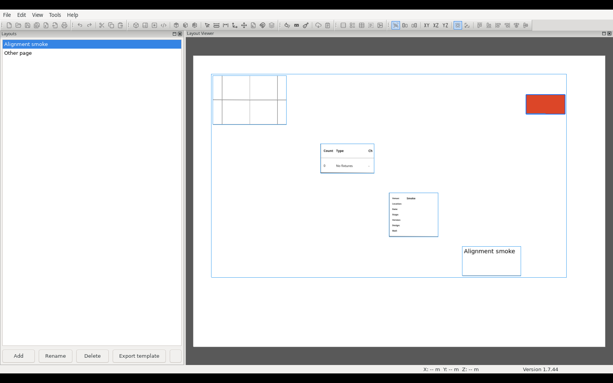
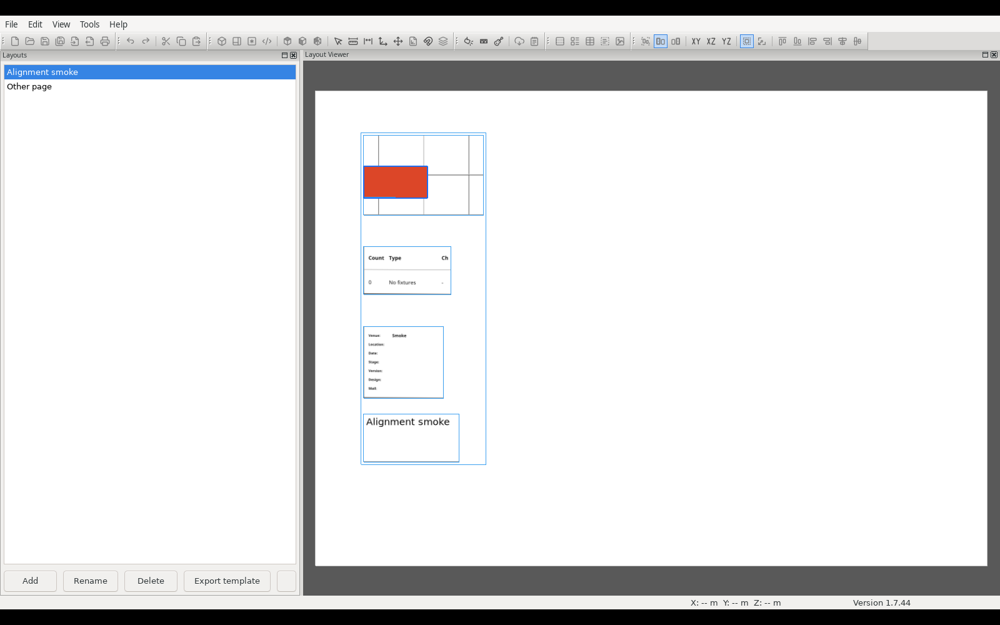

# Layout document alignment

Layout positioning uses the existing `LayoutCollection` payloads and
`LayoutManager::ApplyMutation`. It is independent of scene selection, scene
transforms, MVR serialization and GDTF resources. There is no document schema
migration or second rendering path.

## Identities and selection

`layouts::LayoutElementRef` is `(kind,id)`, scoped to one page name. Chronology is
an ordered vector in `LayoutViewerSelectionState`, never serialized. Add preserves
existing order, Toggle removes or appends, and Retain prunes missing identities.
The newest surviving identity is primary; removing it chooses its predecessor.
Page changes and project replacement clear selection even if numeric IDs repeat.
Unchanged-page refresh and successful positioning retain membership and chronology.
Single clicks replace; Ctrl toggles; Shift adds. A click on an existing group
collapses it on release only if no movement occurred. Modifier clicks cannot drag.

Hit testing uses reverse stable Z order (frontmost frame, independent of selected
state). Marquee intersections append in ascending stable Z order. Equal Z ties
use View2D, Legend, EventTable, Text, Image, then stored vector order. A marquee
adds to existing membership. Empty ordinary clicks clear, and empty drags pan.

## Geometry and representability

All calculations use double-precision paper points. One central adapter maps
`(x,y,width,height)` to `{x,-(y+height),x+width,-y}`; vertical engine offsets are
negated once when returning to page coordinates. Top therefore uses minimum page
Y. Insertion anchors are zero-area rectangles at the page-frame top-left. No
WorldDelta, work-plane projection or scene bounds provider participates.

All six operations and three references use `alignment::Calculate` with one
original snapshot. First/Last use chronological references and keep them stationary.
Frame width/height, Z order, identities, camera, physical scale, free zoom and
presentation settings remain unchanged.

Viewports resolve/set their existing integer-plus-residual storage through
`ResolveViewportFrame` and `SetViewportFrame`. Other kinds retain integer origins;
target origins round to nearest point, ties toward positive infinity, with <=0.5 pt error.
For Extents, if the selection contains integer frames and every anchor is already
within 0.5 pt of the exact target, return a no-op. This bounded settling rule avoids
iterative rounding drift.
It can intentionally retain an existing sub-half-point mismatch. Pure fractional
viewport selections use 1e-9 pt tolerance. A group containing any integer frame
rounds the common translation to integer points; pure viewport groups retain
fractional deltas. Every final frame is validated within the existing +/-200000 pt
position bounds before publication. Unsupported targets, duplicates or non-finite
coordinates reject the entire batch with a diagnostic.

## Transactions and interactions

`LayoutManagerDocumentEdit` positioning/deletion services accept page identity and ordered references,
validate a complete original snapshot, derive one candidate and call ApplyMutation
once. Existing serialization equality suppresses no-op history/dirty/publication.
The resource registry retains image ownership; moving a frame does not import or
repackage image bytes. Batch deletion uses the same resource/history boundary.

`LayoutViewerGroupGesture` captures the complete page, references, original pointer
and starting zoom. Each preview derives from that immutable page and the absolute
pointer delta; only the local panel copy changes. Release publishes one batch.
Escape, capture loss, hidden workspace, page replacement or invalid preview restores
the original local document with no history. Existing single-element resizing
keeps its deferred interaction session. Multiple selection hides resize handles
and all frame drags move the group. Double-click narrows to the clicked element;
multiple-selection context menus expose only batch Delete.

The existing toolbar routes by `layoutModeActive`, independent of focus. Layout
viewport camera editing disables document actions. Plane icons remain disabled
in Layout Mode; anchor tooltips identify complete frames or document top-left
origins. Enablement reads only transient membership, without geometry loading.

## Rendering and verification

During dragging and successful positioning, only placement and selection indices
are refreshed. Existing scene capture and texture caches are retained; content,
clipping, text, image proportions and Z order use the existing preview/PDF paths.
Selection overlays belong to the GL editor and are never exported.

`LayoutViewerSelectionState` tests chronology, typed IDs, modifiers, hit ordering
and marquee intersections. `LayoutDocumentEdit` exercises all reference/operation
combinations, mixed fractional/integer frames, stationary references, no-ops,
viewport setting preservation, batch history, invalid targets/coordinates, image
resources, portable/legacy templates and PSTG packaging. Its opaque MVR callback
checks byte retention without claiming an actual MVR exporter integration test.
Existing physical viewport PDF, preview, model, scene alignment and archive tests
remain required regression coverage. Native smoke validation and platform results
must be reported as actually executed in the PR.

## Native wxWidgets smoke test

`NativeLayoutAlignmentSmoke` launches the production application under a clean
1600×1000 Xvfb display on Linux, using standard-library X11/XTest input. It opens
an actual PSTG containing all five element kinds with overlapping typed IDs and a
second page reusing Text ID 1. It clicks the existing toolbar, drags a selected
viewport, uses Undo/Redo and Escape, switches scene 2D/3D/Layout workspaces, performs
an additive marquee with Last/Top alignment, checks repeated no-op history, and
switches pages. Assertions read persisted document frames through ordinary saves,
including unchanged non-position properties and canonical MVR entry payloads.
No production testing hooks or alternate publication path are introduced.
The native test also deletes the entire selection in one step and restores its
image resource with Undo; Delete on a newly switched page consumes no scene action.

The smoke uses an empty scene and synthetic image. It verifies byte-identical
canonical MVR entries for that scene; physical fixture scene alignment remains
covered separately by `SceneAlignmentPhysicalBounds`. The GUI smoke is Linux-only;
the Core, selection, persistence and PDF tests use the existing Windows/Linux/macOS
Debug CTest matrix. X11/XTest absence produces an explicit skipped test.

Native Linux validation selected all five kinds, applied First/Left through the
shared toolbar, and moved them by a common `(20 pt,15 pt)` delta. Undo, Redo,
Escape, workspace/page transitions and marquee Last/Top were checked against saved
documents. The 1:50 viewport retained its center and fractional frame dimensions.

