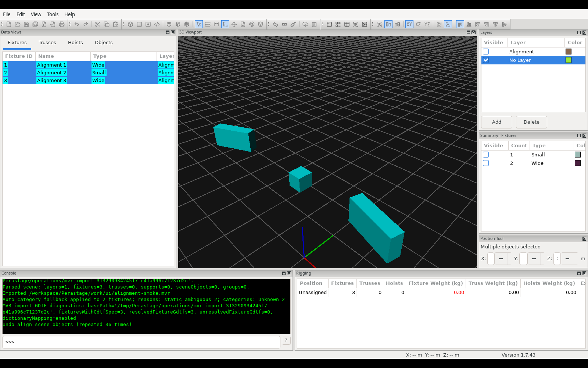
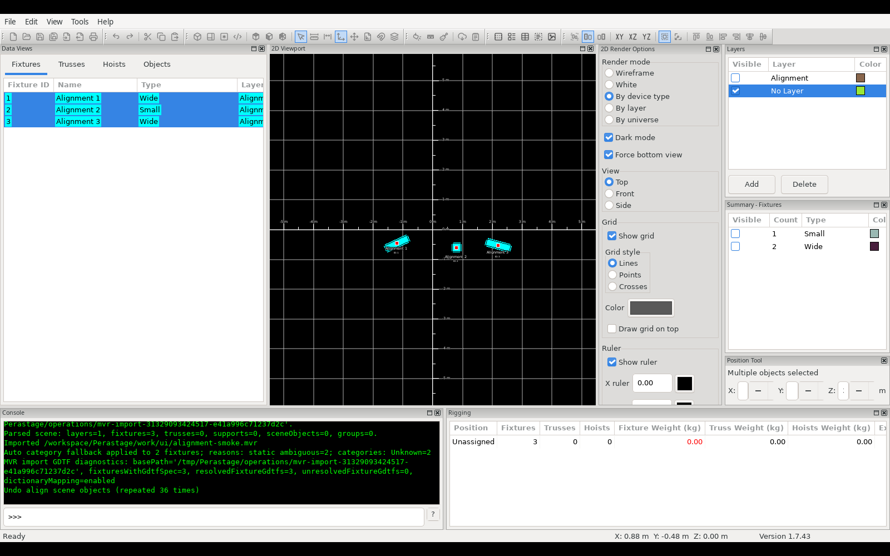

# Scene alignment

PR1 supplies scene alignment only. Layout multi-selection/alignment and universal
distribution remain deferred. Existing fixture distribution is unchanged.

## Ownership and command publication

`alignment_geometry` accepts immutable projected rectangles and implements the six
anchors once. A future Layout adapter can supply document rectangles directly.
`scene_alignment` resolves typed chronological scene identities with
`BuildInteractiveTransformTargets` and the existing interactive promotion policy,
collects the explicitly selected anchors, and passes world-axis translations to `ExecuteBatch`.
The batch validates a complete candidate scene, preserves transform bases and
hierarchy, and publishes through `MutationTransaction` exactly once. A no-op
publishes nothing. Failed validation/loading/publication leaves scene and selection
unchanged. Capture and execution run synchronously on the GUI event thread, so
there is no event yield between geometry capture and commit. Other frontends must
serialize scene mutation on their execution thread too.

The GUI owns controls, localized messages, diagnostics and normal scene/selection
refresh. It performs no bounds or alignment arithmetic. The toolbar remains
accessible in both scene workspaces; actions are disabled in Layout mode. Enablement
resolves identities only and never loads geometry. Publication uses the established
scene refresh boundary; incremental renderer notifications remain owned there.

## Selection chronology

`SelectionState` adds `OrderedSceneSelection`, a runtime vector of typed UUIDs;
vector position is the selection sequence. Category setters reconcile membership:
surviving identities never move, removal deletes the identity, and a later addition
appends it. Thus sorted table/viewer refreshes do not replace chronology. A batch of
new identities in one setter uses ascending UUID order. Calls replacing several
categories use their explicit call order (the existing shared adapters call fixture,
truss, support, scene object, group). This policy makes no claim to individual click
chronology within a rectangle/range selection. Explicit neutral replacement through
`OrderedSceneSelection::Replace` honors caller order, removes duplicates, and does
not reconstruct history from maps. No metadata, dirty state or Undo entry is added
for chronology. Existing Undo snapshots retain order so history restoration does not
change first/last reference identity. Shared command publication uses atomic
`SetSceneSelection` membership synchronization to avoid clearing/re-adding groups. Project replacement clears the selection through existing Reset/load
paths; the ordered-query boundary prunes deleted UUIDs before use.

Normalization preserves the earliest chronological occurrence of each surviving
effective target. A group selected with a descendant or several leaves promoted to
one group produces one target. Suppressed descendants inherit their surviving
group identity using the same interactive target resolver. Missing identities or unresolved
promotion abort with deterministic diagnostics. Reference selection happens after
normalization, so first/last references stay fixed. Explicit group identities are
accepted by the neutral adapter; existing GUI group highlighting/promotion continues
to select groups through their members.

## Anchor policy

`alignment::Anchor` separates geometric bounds (default) from insertion points.
The scene command takes this policy independently of reference, operation and plane.
Insertion-point mode reads `GetTargetWorldTransform(...).o` after effective-target
normalization, validates finite coordinates and projects a zero-area rectangle
representing that known point through the same six algorithms. It never calls the
bounds provider or loads resources. A promoted group uses the group's world origin;
its descendants move once through the existing transactional transform batch.
This is explicit point alignment, never invented physical geometry or an automatic
fallback. Reference/plane semantics and Undo/no-op contracts remain the same.
The toolbar exposes an independent exclusive pair of monochrome icons, defaulting
to geometric bounds each session; switching the anchor creates no history or dirty state.

## Bounds and resource ownership

`SceneBounds` is a CPU provider independent of renderer initialization. It reuses
`GeometryBoundsResolver` for 3DS/GLB, the existing cached GDTF geometry tree for
fixtures and GDTF-backed trusses/supports, and the shared renderer resource path
resolver for scene/library resolution. No new resource manager is introduced.
GDTF mesh coordinates are millimeters and node translations are meters; the provider
converts translations once before measuring local fixture bounds. Immutable fixture
bounds have a bounded 128-entry derived cache keyed by resource identity, mode,
file size and modification time. The loader retains canonical archive ownership,
content validation and extraction leases. Mesh cache invalidation remains in the
existing resolver. World projection transforms all eight local AABB corners using
the full matrix. SceneObject and Support geometry-instance matrices are composed
with the node world matrix. Group bounds union descendants' world bounds; cycles,
missing children and multiply owned geometry abort instead of double counting.

Only actual loaded meshes or authored GDTF primitives with complete positive
dimensions qualify. GDTF dimension-box
fallbacks are explicitly marked nonphysical without changing rendering behavior.
In geometric-bounds mode, missing resources, absent/empty geometry and non-finite
values fail the operation;
there is no implicit insertion-point or invented-size fallback. AABB projection is
conservative for irregular geometry. Dummy supports without physical resources
cannot use geometric alignment; the explicit insertion-point mode remains available.

## Work planes

All calculation uses scene millimeters, independent of UI units and zoom.
Scene alignment uses a 0.01 mm anchor tolerance and predicts the transform
command's float addition before publication. Significant unrepresentable movements
at extreme coordinates abort rather than falsely reporting successful alignment.
The reusable rectangle API accepts an explicit tolerance for document adapters.
The toolbar uses standard 16 px monochrome SVG bundles on the default toolbar
row. Explicit disabled SVG variants use the Layout toolbar gray (#4A4A4A,
0.95 opacity), assigned through `SetDisabledBitmap` rather than automatic
grayscale conversion. Reference, plane and anchor controls are independent radio groups. A one-time
preference migration removes the original forced second-row default while
preserving subsequent user docking. The toolbar is constructed after the other
primary bars, with a measured default position instead of an offscreen sentinel.
Saved offscreen top-dock positions are repaired on workspace restoration; narrow
windows use a second row when the combined toolbar widths do not fit. Control changes do not dirty the project.
In 2D, `WorkPlaneForView` follows the active viewport's Top/Front/Side orientation;
plane buttons show that plane and are disabled. In 3D, `Viewer3DPanel` owns runtime
`m_sceneWorkPlane`, initially XY. The toolbar and selection drag projector use the
same state. Standard views update it; camera orbit does not derive a plane from yaw.
Free selection dragging intersects the mouse ray with the selected world plane
through the current anchor. Axis Lock uses world/local directions projected onto
that plane. Degenerate axes and parallel rays produce no movement. Magnet is deliberately exempt from the plane constraint: its existing full
translation/attachment behavior can reach a nearby element outside the plane. Continuous placement retains its
existing camera-plane/axis behavior; fixture distribution is unchanged.

| Plane | Screen horizontal | Screen vertical | Unchanged axis |
| --- | --- | --- | --- |
| XY | +X | +Y | Z |
| XZ | +X | +Z | Y |
| YZ | -Y | +Z | X |

Left/right refer to projected visual edges, including mirrored Side Y. Top uses
maximum projected vertical extent. Only one corresponding world translation
component changes per operation; rotation, scale and the other two coordinates
are preserved. Extents and all deltas use one original immutable bounds snapshot.

## Validation

`SceneAlignment` exercises the pure calculations, mixed chronology, policy
normalization, repeated no-ops and transactional publication failure without GL.
`SceneAlignmentPhysicalBounds` uses production CPU loaders, a real primitive GDTF
archive and a bundled 3DS, including rotated fixtures/trusses, instance transforms,
nested groups, missing resources, invalid transforms and dimension-box rejection.
The existing batch, grouping and MVR interchange regressions remain relevant.
`SceneAlignmentBoundary` guards the GUI-independent geometry/command boundary.
Insertion-point regressions cover all reference/operation/plane combinations,
no resource-provider calls, differing physical widths, group origins, non-finite
points and the same transaction/no-op/transform-basis contracts.
These CTest tests run through the existing platform CI matrix.

## Native toolbar evidence

Linux wxWidgets application smoke test with three real GDTF primitive fixtures,
including different dimensions and two rotated instances. Selection chronology was
fixture 2, fixture 1, fixture 3, despite the fixture table displaying 1, 2, 3.
First-selected Top in XY produced a shared maximum Y of -475 mm; repeating it
created no extra Undo entry. One Undo restored original bounds and Redo restored
the aligned result. Switching to the 2D workspace retained fixture 2 as reference;
Bottom produced a shared minimum Y of -725 mm. X/Z, rotations and scales stayed
unchanged. Canonical GUI MVR export and headless reread retained UUIDs, physical
models, modes, DMX and transformed matrices.

The insertion-point toolbar passed all 54 reference/operation/plane combinations
in 3D, with Undo restoring each original selection snapshot. A 2D insertion-point
operation was checked across workspace switching, Undo/Redo and a repeated no-op.
The current 3D capture shows insertion-point alignment; the 2D capture shows
geometric bounds after switching back with the independent anchor icon pair.

A native restart regression also opened a saved project with the legacy alignment
dock position of 10000 and the inline-migration preference already set. The
complete toolbar recovered on the main row in 2D and remained visible after
switching to 3D.

